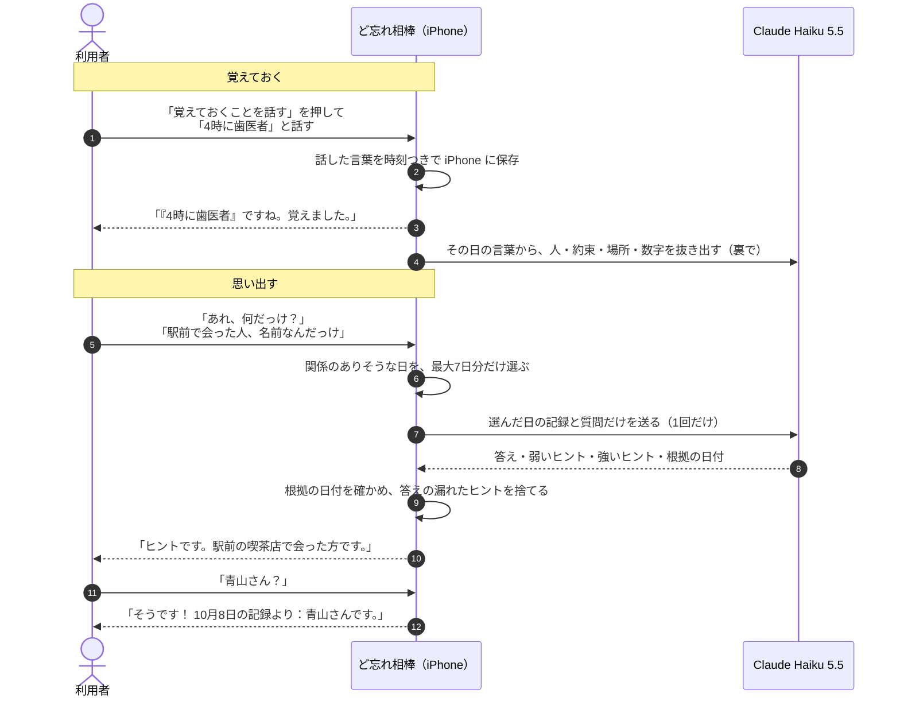
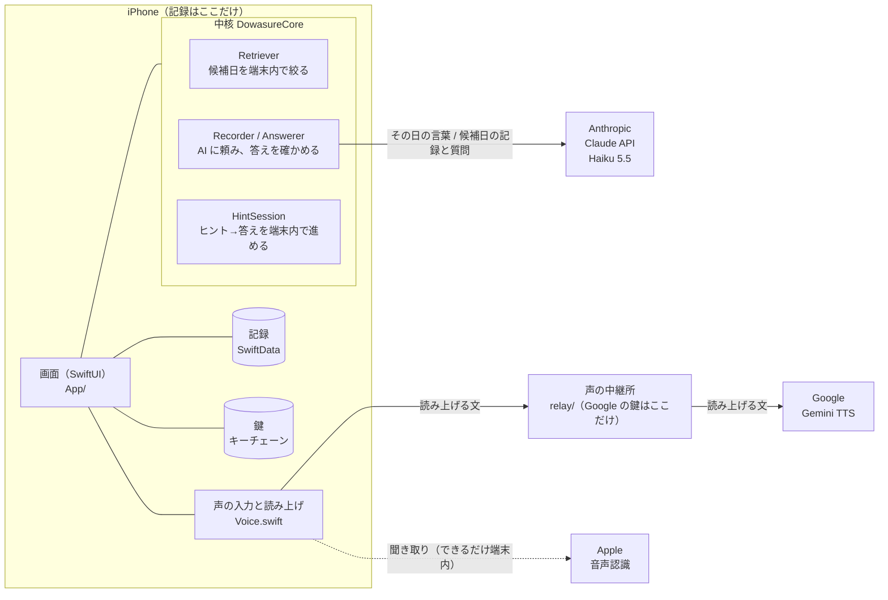

# ど忘れ相棒

**忘れそうなことをパッと話すと覚えてくれて、「何だっけな」の時は、答えではなくヒントで思い出させてくれる iPhone アプリ。**


> 「忘れてしまうだろうなと思ったことをパッと話して記憶してくれる。そして『何だっけな』と思い出すときに、答えを言うのではなくてヒントを言う。」
> — 制作者・藤川（2026-11-03）

Built with Claude: Japan 2026 の応募作品です。2026年11月2日から、期間中に新しく作りました。制作者の藤川（65歳）はプログラマーではありません。企画・実機での試用・判断を藤川が、設計・実装・テストを Claude Code が担当しています。

---

## 目次

1. [誰の、何を助けるのか](#誰の何を助けるのか)
2. [使い方の流れ](#使い方の流れ)
3. [できること](#できること)
4. [安心して使えるための作り](#安心して使えるための作り)
5. [シニアフリー・ユニバーサルデザイン](#シニアフリーユニバーサルデザイン)
6. [しくみ](#しくみ)
7. [正確さの測り方](#正確さの測り方)
8. [Claude Code との作り方](#claude-code-との作り方)
9. [作りながら直したこと](#作りながら直したこと)
10. [動かし方](#動かし方)
11. [フォルダの中身](#フォルダの中身)
12. [文書一覧](#文書一覧)
13. [ライセンス](#ライセンス)

---

## 誰の、何を助けるのか

年を重ねると、「さっき聞いた名前」「来週の約束」「買う物」が、ふっと出てこなくなります。メモを書けば済む話ですが、小さな文字を打つのは面倒で、書いた場所も忘れます。

ど忘れ相棒は、**話すだけで覚えてくれる相棒**です。思い出したい時も、すぐに答えを言いません。**ヒントを出して、自分で思い出すのを手伝います。** 答えを聞くだけより、自分で思い出せた方がうれしい、という藤川の考えから、この形になりました。

## 使い方の流れ



ヒントから答えまでの会話は iPhone の中だけで進みます。AI への問い合わせは最初の1回だけなので、2つ目のヒントや答えは待たずに出ます。

## できること

| 機能 | 内容 |
|---|---|
| **覚えておくことを話す** | 押すと「覚えておきたいことを、話してください」と促します。時間帯に関係なく、何度でも話して記録できます。話した言葉をそのまま読み返すので、聞き間違いにも気づけます。「いまのを取り消す」で直前の1件を消せます。 |
| **あれ、何だっけ？** | 声か文字で聞くと、まずヒントを出します。名前を言えば「そうです！」、違えば次のヒント。「答えを教えて」「わからない」で、根拠の日付つきの答えを伝えます。記録に無いことは「見当たりません」と答えます。 |
| **自分で思い出せた記録** | ヒントだけで言い当てると、やさしいチャイムと振動で「そうです！ご自分で思い出せましたね。」。ホームに「この1週間で、ご自分で◯回思い出せました。」と出します。答えを聞いた回は数えず、0回の時は何も出しません。記録は iPhone の中だけです。 |
| **Siri で一言** | 「ど忘れ相棒で覚えて」で話す画面、「ど忘れ相棒で何だっけ」で思い出す画面が開きます。設定は要りません。同じものを横のボタン（アクションボタン）にも割り当てられます。 |
| **毎晩のお知らせ** | 決めた時刻（最初は20時）に「忘れたくないことはありますか？」と通知します。押すと、そのまま話す画面が開きます。 |
| **自然な声** | Google の Gemini の音声で、低め・ゆっくり・はっきり話します。使えない時は自動で iPhone の声に切り替えます。AI が考えている間は、やさしい響きの低い「ポンポンポン」が鳴ります。 |

## 安心して使えるための作り

- **記録は iPhone の中だけに保存します。** 開発者のサーバーはありません。記録は iPhone の SwiftData（アプリ内のデータベース）に入ります。
- **AI に送るのは必要な分だけです。** 抜き出しにはその日に話した言葉を、質問には関係のありそうな日（最大7日分）だけを、Anthropic の Claude API に送ります。
- **根拠の日付は AI に書かせません。** AI が「根拠」と返した日付のうち、実際に AI へ渡した日だけを残し、「10月8日の記録より」の文言はアプリが組み立てます。根拠が残らなければ「見当たりません」と答えます。作り話を、仕組みで防いでいます。
- **ヒントに答えが入っていたら捨てます。** 答えの言葉（漢字・かな）がヒントに入っていないかを、アプリが確かめます。
- **鍵（API キー）は iPhone のキーチェーンに保存します。** このリポジトリにもアプリの中にも入れていません。コミット前の自動点検（[`.githooks/pre-commit`](.githooks/pre-commit)）が、鍵らしい文字列や `secrets/` のファイルを止めます。
- **医療や診断は行いません。** 暮らしの助けとして使うアプリです。

どこに何を送り、何を保存するかの全体は [docs/プライバシーと安全.md](docs/プライバシーと安全.md) にまとめています。

## シニアフリー・ユニバーサルデザイン

藤川の指示「高齢者は高周波は聞こえないことも考慮してください。ユビキタス、全体的に。」から、アプリ全体の決まりにしました。

| 決まり | 具体的に |
|---|---|
| 音は低く | 待ち時間の音は 392Hz（ソ）。倍音を含めて1kHz未満 |
| 声は低め・ゆっくり・はっきり | Gemini への指示と、iPhone の声の高さ（0.9倍） |
| 文字とボタンは大きく | どの画面にも大きな「ホームにもどる」。最大の文字サイズでもボタンの文字が切れない |
| 色の読みやすさ | 白い文字の背景はコントラスト比4.5以上（濃いオレンジ5.3、濃い緑5.5、濃い赤5.9） |
| 色だけに頼らない | 注意は赤い文字だけでなく、印と言葉で示す |
| 音だけに頼らない | 話した言葉・答えは必ず文字でも表示。聞き始めと終わりは振動でも知らせる |
| 考える時間を待つ | 話し始めるまで20秒待つ。話し始めてからは4秒の間で区切る |
| 間違いは取り消せる | 「いまのを取り消す」 |

詳しくは [docs/ユニバーサルデザイン.md](docs/ユニバーサルデザイン.md)。

## しくみ



- AI の答えは、決まった形（JSON スキーマによる構造化出力）で受け取ります。
- 決まった指示文（システムプロンプト）は固定にして、プロンプトキャッシュが効くようにしています。
- 自律的に動くエージェントではなく、手順の決まったワークフロー型です（Anthropic の「Building Effective Agents」の考え方に合わせました）。

部品ごとの説明は [docs/設計.md](docs/設計.md)。

## 正確さの測り方

架空の高齢者の記録25日分と、質問30問で採点しています。30問のうち8問は、記録に答えが無い質問です。眼鏡の人が2人、似た名前（田村さん・村田さん）、変更された約束などの「ひっかけ」も入れました。

2026-11-03 の結果（Claude Haiku 5.5、本物の API）：

| 測ったこと | 結果 |
|---|---|
| 答えられる質問の正答 | 22問中22問 |
| 記録に無い質問に「見当たりません」と答えた | 8問中8問 |
| 正答にヒントが付いた | 22問中22問 |
| ヒントに答えが漏れた | 22問中0問 |

正直に書いておくと、この採点データは制作側（Claude）が作ったもので、問題数も少なめです。このデータを見ながら検索を直したので、実際より良い点が出ている恐れがあります。藤川の実際の記録で確かめ直す予定です。採点の方法は [docs/採点.md](docs/採点.md)。

## Claude Code との作り方

藤川がコードを書かずに作るため、Claude Code の機能を役割ごとに使い分けています。

| 使ったもの | 何に使ったか |
|---|---|
| 本体のエージェント | 設計、実装、テスト、統合、藤川とのやり取り |
| サブエージェント | 採点テスト一式の作成、公開前の秘密情報の独立点検、音声合成の仕様調査。[`.claude/agents/`](.claude/agents/) に4人の係（高齢の利用者役・ヒント漏れの審査員・iOS 技術者・大会の審査員）を置き、作った本人と別の目で見る |
| スキル | [`.claude/skills/`](.claude/skills/)：開発記録の書き方、公開前の点検 |
| MCP（iOS シミュレーター操作） | 画面を撮影・タップして、見た目と動きを確認 |
| ブラウザ操作 | 料金表などを公式ページで確認 |
| フック（git の pre-commit） | 鍵や個人の記録がコミットされるのを自動で止める |
| フック（Claude Code、[`.claude/settings.json`](.claude/settings.json)） | 書き込む前に鍵を止める、公開の切り替えは確認を出す、アプリの文に医療めいた言葉が入ったら知らせる、終える前にテストと開発記録の追記を確かめる |
| `CLAUDE.md` | 目的・守ること・既知の問題を書き、どのセッションでも同じ決まりで作る |
| プロジェクトの並行スレッド | アプリの制作、調査、このリポジトリの整備を、別々のスレッドで並行して進める |

失敗した使い方も含めた詳しい記録は [docs/Claude活用.md](docs/Claude活用.md)。

## 作りながら直したこと

藤川が実機で使った感想で、作りが大きく変わりました。一部を抜き出します。

| 藤川の声 | 変えたこと |
|---|---|
| 「何を話すか考えているうちに、元に戻ってしまいます」 | 話し始めるまで20秒待つ |
| 「戻るボタンが左上の小さな矢印だけだと非常にわかりにくい」 | 大きな「ホームにもどる」 |
| 「1980年代に戻ったような感じがします。2026年風にしてください」 | Gemini の自然な声に |
| 「5秒ほど黙る時間、非常に気になる」 | 決まり文句の保存、届いた分から話す、待ち時間の音 |
| 「相槌が非常に不自然ですね」 | 相づちをやめ、言葉でない「ポンポンポン」に |
| 「いきなり答えをポンと言うのではなく、まずはヒントを」 | ヒントから思い出す作りに全面変更 |
| 「高齢者は高周波は聞こえないことも考慮してください」 | 音を低く、声を低め・ゆっくりに |
| 「親指はiPhoneに対して下半分しか使えません」 | ボタンはすべて画面の下半分へ。上半分は読むものだけ |

時系列の全記録（問題 → 原因 → 対応 → 結果、うまくいかなかった案も）は [docs/開発記録.md](docs/開発記録.md) にあります。

## 動かし方

必要なもの：Xcode 26 以降の Mac、[XcodeGen](https://github.com/yonaskolb/XcodeGen)、iOS 26 以降の iPhone（声の確認は実機で行います）。

```bash
git clone https://github.com/TadFuji/dowasure-aibou.git
cd dowasure-aibou
git config core.hooksPath .githooks   # 鍵のコミットを止める点検を有効にする

# 中核部分のテスト（Mac だけで動く。通信しない）
cd DowasureCore && swift test && cd ..

# アプリを作る
xcodegen generate
open DowasureAibou.xcodeproj
```

アプリを起動したら、設定画面で **Claude API の鍵を1つだけ** 入れます（[Anthropic Console](https://console.anthropic.com/) で作成）。

自然な声のための Google の鍵は、利用者には入れてもらいません。作者が置いた「声の中継所」（`relay/`、Vercel で動く小さなサーバー）が鍵を持ち、読み上げる文を Gemini に取り次ぎます。中継所は文を保存せず、決まったモデル・声・長さ（400文字まで）の頼みだけを通します。中継所が使えない時は、自動で iPhone の声で話します。よく使う決まった言葉は、Gemini の声で録ってアプリに同梱しています（`App/Resources/Voice`）。

中継所を自分で立てる場合は、`relay/` を Vercel に置き、環境変数 `GEMINI_API_KEY` に有料の Gemini API の鍵（[Google AI Studio](https://aistudio.google.com/)）を入れ、`CloudVoice.relayEndpoint` をその URL に変えます。

鍵はキーチェーンに保存され、ファイルには残りません。

### テスト

| 種類 | 実行 | 内容 |
|---|---|---|
| 単体テスト | `cd DowasureCore && swift test` | 35件。検索、答えの検証、ヒントの進め方、待ち時間など（AI は模擬の応答） |
| 採点（検索だけ） | `cd DowasureCore && swift run DowasureEval` | 通信なし。正解の日を候補に拾えたか |
| 採点（本物の AI） | `cd DowasureCore && swift run DowasureEval --live` | 鍵を `secrets/anthropic_api_key` に置いた時だけ |
| 画面の通しテスト | `xcodebuild test -scheme DowasureAibou ...` | 6本。記録→取り消し、鍵の保存、お知らせ、ヒント→答えなど |

## フォルダの中身

```text
.
├── App/                  画面（SwiftUI）、声、保存、毎晩のお知らせ
├── DowasureCore/         中核（Swift Package。Mac でテストできる）
│   ├── Sources/DowasureCore/   Claude API、検索、答えの検証、ヒント、Gemini の声
│   ├── Sources/DowasureEval/   採点ツール
│   ├── Tests/                  単体テスト
│   └── Fixtures/               架空の記録と採点用の質問
├── UITests/              画面の通しテスト
├── docs/                 開発記録・設計・プライバシーなど
├── .claude/skills/       Claude Code 用のスキル（開発記録の追記、公開前の点検）
├── .claude/agents/       Claude Code の係（高齢の利用者役、ヒント漏れの審査員、iOS 技術者、大会の審査員）
├── .claude/hooks/        Claude Code のフック（鍵・公開・医療めいた言葉・終える前の確認）
├── .github/              Issue と PR のひな形、秘密情報の自動点検
├── .githooks/pre-commit  鍵のコミットを止める点検
├── project.yml           Xcode のプロジェクト定義（XcodeGen）
└── CLAUDE.md             Claude Code への説明書（目的・守ること・既知の問題）
```

## 文書一覧

| 文書 | 内容 |
|---|---|
| [docs/開発記録.md](docs/開発記録.md) | 時系列の全記録。藤川の言葉、問題と対応、あきらめた案 |
| [docs/設計.md](docs/設計.md) | 部品の役割と、データの流れ |
| [docs/プライバシーと安全.md](docs/プライバシーと安全.md) | どこに何を送り、何を保存するか |
| [docs/ユニバーサルデザイン.md](docs/ユニバーサルデザイン.md) | 高齢の方に向けた決まりと、その理由 |
| [docs/採点.md](docs/採点.md) | 採点データの作り方と結果、その限界 |
| [docs/Claude活用.md](docs/Claude活用.md) | Claude Code の機能をどう使い分けたか |
| [SECURITY.md](SECURITY.md) | 問題を見つけた時の連絡先 |

## ライセンス

[MIT ライセンス](LICENSE)です。

<details>
<summary>English summary</summary>

**Dowasure Aibou** ("tip-of-the-tongue buddy") is an iPhone app for older adults, built for Built with Claude: Japan 2026. You say what you might forget ("dentist at 4", "buy carrots"); it saves your own words on the device. When you later ask "what was it again?", it does not blurt out the answer. It gives a hint first and lets you recall it yourself; the answer, with the date of the record it came from, comes when you name it or ask for it.

- Records stay on the iPhone (SwiftData). Only the relevant days (up to 7) are sent to the Claude API (Claude Haiku 5.5) with structured outputs.
- Evidence dates are verified in code against the records actually sent; hints that leak the answer are dropped in code.
- Senior-friendly design throughout: low-pitched sounds (< 1 kHz), large text that never truncates, contrast ≥ 4.5:1, haptics, undo.
- The maker (65, not a programmer) never wrote code; Claude Code designed, built and tested everything. See `docs/開発記録.md` for the full log.

</details>
