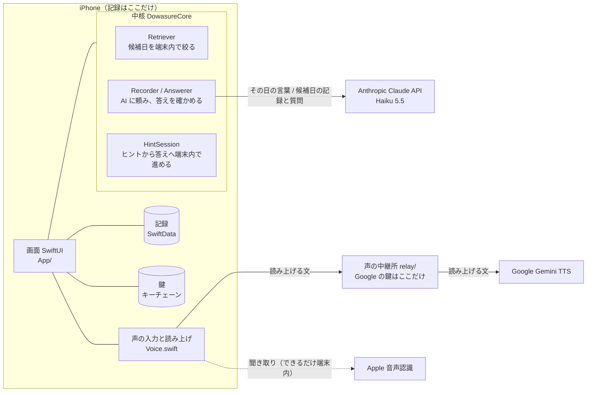

# ど忘れ相棒

**忘れそうなことをパッと話すと覚えてくれて、「何だっけな」の時は、答えではなくヒントで、自分で思い出すのを手伝う iPhone アプリ。**


> 「忘れてしまうだろうなと思ったことをパッと話して記憶してくれる。そして『何だっけな』と思い出すときに、答えを言うのではなくてヒントを言う。」
> — 制作者・藤川（2026-11-03）

**誰のためか**：スマホに慣れていない高齢の方。「さっき聞いた名前」「来週の約束」が、ふっと出てこない時のために。
**どう作ったか**：Built with Claude: Japan 2026 の応募作品です。2026-11-02 から期間中に新しく作りました。制作者の藤川（65歳）はプログラマーではなく、コードを1行も書いていません。企画・実機での試用・判断を藤川が、設計・実装・テストを Claude Code が担当しました。

## 3つの柱

| 柱 | 藤川の言葉（2026-11-07） | アプリでは |
|---|---|---|
| **① とてもシンプル** | 「高齢者がスマホなどに慣れていなくても直感的に使えること、それが非常に重要です。」 | ホームの大きなボタンは2つだけ（「覚えておくことを話す」「あれ、何だっけ？」）と「設定」。押すものはすべて画面の下半分、上半分は読むものだけ |
| **② 答えでなくヒント**（いちばん大事） | 「答えを教えるのではなくて思い出させるアシストをする ということ。そこが最も重要です。」 | ヒントは3段（場面 → 手がかり → 最初の1音）。答えはコードが点検し、漏れたヒントは捨てる。答えは本人が言い当てた時か、頼んだ時だけ |
| **③ 1〜2年使える記録** | 「ユーザーは1〜2年使うことを想定して、（中略）どこに記録していくのかということも慎重に考えてください。」 | 記録は iPhone の中だけ。ご家族が控えを書き出せる。保存の場所が開けなくても落ちず、記録を消さない |

## 答えでなく、ヒント（会話の例）

```text
利用者：駅前で会った人、名前なんだっけ
相棒　：ヒントです。3日前、駅前の喫茶店でお会いした方です。思い出せたら、言ってみてください。
利用者：……森山さん？
相棒　：「森山さん」と聞こえました。記録の言葉とは少し違うようです。
　　　　もう一つヒントです。前の職場でご一緒だった、丸い眼鏡の方です。
利用者：あ、森田さん！
相棒　：そうです！ご自分で思い出せましたね。
　　　　11月4日の記録より：森田さんです。
```

架空の記録（[`SampleData.swift`](DowasureCore/Sources/DowasureCore/SampleData.swift)）での例です。「ヒントです」「と聞こえました」「そうです！ご自分で思い出せましたね」はアプリの決まった言葉（[`HintSession.swift`](DowasureCore/Sources/DowasureCore/HintSession.swift)）、ヒントの中身は Claude が毎回作ります。「◯月◯日の記録より」はアプリが組み立てます。

## 数字で見る

| 項目 | 結果 | 出典 |
|---|---|---|
| 答えのある質問に正しく答えた | **22 / 22** | 本物の Claude Haiku 5.5 で採点（2026-11-07、4回目） |
| 記録に無い質問に「見当たりません」と答えた | **8 / 8** | 同上 |
| ヒントに答えの言葉が入った（コードの点検） | **0 / 22** | 同上。出たヒントは全部、Claude も読んで確かめた |
| 答えが出るまでの待ち時間 | 平均 4.3秒、最長 9.8秒 | 同上 |
| 中核の単体テスト | **58件**（Mac で全件成功） | `DowasureCore/Tests`、2026-11-07 18:28 |
| 画面の通しテスト | **6本**（本物の Claude を使う2本を含む。全件成功） | `UITests/`、2026-11-07 19:50 |
| 声の中継所のテスト | 6件（成功） | `relay/speak.test.js` |

採点の問題は架空の30問で、制作側が作ったものです。良く出すぎている恐れもあります（[限界](docs/採点.md)）。

## 高齢者に使いやすくするために直したこと

藤川（65歳）が実機で触り、感じたことを言葉にし、Claude Code がその場で直す。その繰り返しで、高齢の方に使いやすい形を探しました。[開発記録](docs/開発記録.md) には、**藤川の言葉83件**（そのままの言葉で）と、**うまくいかなかった案40件以上**を残しています。

| 工夫 | 藤川の言葉 | どう変えたか | なぜ高齢の方に効くか |
|---|---|---|---|
| **長く待つ聞き取り** | 「何を話すか考えているうちに、元に戻ってしまいます」（11/03） | 約3秒で切れていた聞き取りを、話し始めるまで20秒待ち、話した後は4秒の間で区切るように | 話す前に考える時間が要る。途中で切られると、もう一度押す気力がなくなる |
| **大きな「ホームにもどる」** | 「戻るボタンが左上の小さな矢印だけだと非常にわかりにくい」（11/03） | どの画面にも、文字で書いた大きなボタン | 小さな矢印は見えにくく、意味も伝わりにくい |
| **親指が届く下半分のボタン** | 「親指はiPhoneに対して下半分しか使えません」（11/07） | 押すものはすべて画面の下半分。上半分は読むものだけ | 片手で持ったまま、持ち替えずに押せる。落とす心配も減る |
| **大きな文字と、読みやすい色** | 「もっとUIをシンプルにわかりやすく、大きめに作ってください」（11/03） | 最大の文字サイズでもボタンの文字が切れない。白い文字の背景はコントラスト比4.5以上（iPhone 標準のオレンジ・緑は約2.2で使わない） | 年とともに、小さな文字や薄い色の差が読みにくくなる |
| **色だけに頼らない** | 「シニアフリー」「ユニバーサルデザイン」（11/03） | 注意は赤い色だけでなく、印と言葉で示す | 色の見え方は人によって違う。言葉なら誰でも分かる |
| **低くやさしい音** | 「ちょっと電子音っぽくて冷たさがありますね」「高齢者は高周波は聞こえないことも考慮してください」（11/03） | 待ち時間の音は 392Hz（ソ）の木琴のような音に響きを足し、すべて1kHz未満に | 高い音から聞こえにくくなる。冷たい音は不安にさせる |
| **怖くない声** | 「ロボットぽくて怖い」「1980年代に戻ったような感じ」「5秒ほど黙る時間、非常に気になる」（11/03） | 声を何度も試して、Gemini の自然な声に。低め・ゆっくり・はっきり。よく使う言葉は録音して同梱し、待たせない | 怖い声や長い沈黙は「壊れた？」と感じさせ、使うのをやめてしまう |
| **振動でも知らせる** | 「シニアフリー」「ユニバーサルデザイン」（11/03） | 聞き始めと終わりに、ブルっと振動 | 音が聞こえにくくても、今が話す番だと分かる |
| **音量0でも使える** | 「いえ、音量が０でも使えるUIにしてください。」（11/07） | 音が出ない時は、すぐマイクに進み、「どうぞ、お話しください」を大きな枠で示す。「もう一度きく」を押せば、振動と文字で知らせ、音を上げたらすぐ読み上げる | 音量を下げたままの方は多い。設定を直してもらうより、そのままで使えるほうがいい |
| **間違いは取り消せる** | 「シニアフリー」「ユニバーサルデザイン」（11/03） | 「いまのを取り消す」で、直前に覚えた1件を消せる | 聞き間違いや言い間違いが怖くなくなる |
| **鍵は1つだけ** | 「Claude の API キーと（中略）Google の API キーの2つを入力させるというのは負担になると思うんですよね」（11/07） | 声の中継所を作り、利用者が入れる鍵を1つに | 長い文字列を2回打つのは、慣れない方には大きな壁 |

いちばん大事な「答えでなくヒント」も、藤川の言葉「いきなり答えをポンと言うのではなく、まずはヒントを」（11/03）から生まれました。ヒントの決まりは本物の Claude で4回採点し、出たヒントを全部読んで3回直しています（[採点.md](docs/採点.md)）。決まりの全体とコードの場所は [docs/ユニバーサルデザイン.md](docs/ユニバーサルデザイン.md)。

## こういう人たちに点検させました

作った Claude 本人とは別の目で見るため、4人の係（Claude Code のサブエージェント、[`.claude/agents/`](.claude/agents/)）を作り、2026-11-07 の夜に藤川の Mac の Claude Code から名前で呼んで、アプリ全体を点検させました。係はコードを書き換えず、指摘だけを返します。

| 係 | どんな人か | 見つけた主なこと | 直したこと |
|---|---|---|---|
| **高齢の利用者役** [`elder-user-reviewer`](.claude/agents/elder-user-reviewer.md) | 70代。iPhone は電話と LINE くらい。老眼で、カタカナ語が分からない | 濃い色の「答えを教えて」が一番目立ち、うっかり押しそう。「APIキー」という言葉が分からない | 「もう少しヒント」を濃い色に。利用者に見せる文から「APIキー」をなくした |
| **ヒントの審査員** [`hint-leak-judge`](.claude/agents/hint-leak-judge.md) | 答えを漏らしたヒントを、一番の失敗と考える人 | 「◯月の明日」というヒントで、答えの日にちが分かる。**自動の判定（0問）では見つからない漏れ** | ヒントの決まりに3つ足した（今日から数える言い方で日付を言わない、など） |
| **iOS の技術者** [`ios-reviewer`](.claude/agents/ios-reviewer.md) | 音声・マイク・保存に詳しい技術者 | 読み上げを途中で止めると待ち音が鳴り続ける。電話中にマイクを始めると落ちることがある。設定に「外に送るもの」が書かれていない | 待ち音とマイクの後始末、落ちないための確認、設定に「外に送るもの」を書いた |
| **大会の審査員** [`hackathon-judge`](.claude/agents/hackathon-judge.md) | 公式の配点どおりに、ほかの作品と並べて厳しく見る人 | 一番の弱点はデモ（動画と画面写真が無い） | 11/08 の撮影で入れる |

16件を直し、直した後に同じ係へもう一度見直させました。全部の指摘、直さなかったものとその理由、フックの試しは [docs/係の点検.md](docs/係の点検.md) にあります。

## 審査員の方へ

- **5分で全体をつかむ**：[docs/審査員の方へ.md](docs/審査員の方へ.md)
- **試行錯誤の跡**：[高齢者に使いやすくするために直したこと](#高齢者に使いやすくするために直したこと)、全記録は [docs/開発記録.md](docs/開発記録.md)（藤川の言葉を原文で、問題 → 原因 → 対応 → 結果、うまくいかなかった案も）
- **Claude Code の使い分け**：[Claude Code との作り方](#claude-code-との作り方)、実物は [`.claude/`](.claude/)。4人の係に実際に点検させた記録は [docs/係の点検.md](docs/係の点検.md)
- **ヒントの作りの中心**：[`Prompts.swift`](DowasureCore/Sources/DowasureCore/Prompts.swift)（指示文）、[`Services.swift`](DowasureCore/Sources/DowasureCore/Services.swift) の `Answerer.verify`（点検）

---

## 目次

1. [誰の、何を助けるのか](#誰の何を助けるのか)
2. [使い方の流れ](#使い方の流れ)
3. [できること](#できること)
4. [ヒントを出すしくみ](#ヒントを出すしくみ)
5. [記録の保存（1〜2年使う前提）](#記録の保存12年使う前提)
6. [安心とプライバシー](#安心とプライバシー)
7. [シニアフリー・ユニバーサルデザイン](#シニアフリーユニバーサルデザイン)
8. [しくみ](#しくみ)
9. [Claude Code との作り方](#claude-code-との作り方)
10. [藤川の声で変わったこと](#藤川の声で変わったこと)
11. [動かし方とテスト](#動かし方とテスト)
12. [まだ確かめていないこと](#まだ確かめていないこと)
13. [フォルダと文書](#フォルダと文書)
14. [English summary](#english-summary)

---

## 誰の、何を助けるのか

年を重ねると、名前や約束や買う物が、ふっと出てこなくなります。メモを書けば済む話ですが、小さな文字を打つのは手間で、書いた場所も忘れます。

ど忘れ相棒は、**話すだけで覚えてくれる相棒**です。思い出したい時も、すぐに答えを言いません。答えを聞くだけより、自分で思い出せた方がうれしい、という藤川の考えからです。

続けて使ってもらうための工夫：

- **毎晩のお知らせ**：決めた時刻（最初は20時）に「忘れたくないことはありますか？」。押すと話す画面が開きます。
- **Siri で一言**：「ど忘れ相棒で覚えて」「ど忘れ相棒で何だっけ」。アプリを探さずに始められます。
- **励ましだけを見せる**：ヒントだけで言い当てると、ホームに「この1週間で、ご自分で◯回思い出せました。」。0回の時は何も出しません（採点されている感じを避けるため）。

## 使い方の流れ


AI への問い合わせは最初の1回だけです。2つ目のヒントや答えは、iPhone の中で待たずに出ます。

## できること

| 機能 | 内容 |
|---|---|
| **覚えておくことを話す** | 時間帯に関係なく、何度でも話して記録。話した言葉をそのまま読み返すので、聞き間違いに気づけます。「いまのを取り消す」で直前の1件を消せます |
| **あれ、何だっけ？** | 声か文字で聞くと、まずヒント。名前を言えば「そうです！」、違えば聞こえた言葉を伝えて次のヒント。「答えを教えて」で、根拠の日付つきの答え。記録に無いことは「見当たりません」と答え、いつ頃かを聞き返します |
| **自分で思い出せた記録** | 言い当てた時は、低い2音のチャイムと振動。答えを聞いた回は数えません |
| **Siri で一言** | 7つの言い方を登録（[`SiriShortcuts.swift`](App/SiriShortcuts.swift)）。同じものを横のボタン（アクションボタン）にも割り当てられます |
| **毎晩のお知らせ** | 時刻は設定で変えられます |
| **自然な声** | Gemini の声で、低め・ゆっくり・はっきり。使えない時は自動で iPhone の声に。音量が0でも、声を待たせずに文字と振動で進みます |
| **記録の保管（ご家族向け）** | 記録をテキストで書き出す。すべて消す時は確認つき |

## ヒントを出すしくみ

AI に任せるのは「言葉づくり」だけです。答えを漏らさないこと、根拠の日付、ヒントから答えへの進め方は、アプリのコードが決めます。

| 段階 | だれが | 何をするか |
|---|---|---|
| 1. 候補日を選ぶ | コード（[`Retriever.swift`](DowasureCore/Sources/DowasureCore/Retriever.swift)） | 時期の言葉（昨日、先月、去年の夏…）で範囲を決め、名前・文字の重なりで順位を付けて最大7日。AI は使わない |
| 2. ヒントと答えを作る | Claude Haiku 5.5（[`Prompts.swift`](DowasureCore/Sources/DowasureCore/Prompts.swift)） | 決まった形（JSON スキーマの構造化出力）で、ヒント3段・答え・正解とみなす言葉（漢字と読み）・根拠の日付を一度に返す |
| 3. 点検する | コード（`Answerer.verify`） | 根拠の日付は「実際に AI へ渡した日」だけ残す。残らなければ「見当たりません」。答えの言葉が入ったヒントは捨てる。「◯月◯日の記録より」はコードが組み立てる |
| 4. 進める | コード（[`HintSession.swift`](DowasureCore/Sources/DowasureCore/HintSession.swift)） | 空白・「さん」・ひらがなとカタカナの違いを無視して、言い当てたかを端末内で判定 |

**ヒントの3段**：① 場面（いつ・どこで）② 手がかり（特徴・間柄）③ 最初の1音（数字なら桁数と最初の数字）。答えの2文字以上、読み、言い換えは禁止と指示文に書いてあります。

**ヒントの決まりは採点で4回直しました**（2026-11-07）。コードの点検は4回とも漏れ0件でしたが、出たヒントを全部読むと、言い換えの漏れが見つかりました。

| 回 | 見つかったこと | 直したこと |
|---|---|---|
| 1 | 考える量（effort）を low にすると速い（平均2.4秒）が、「雪のような色」（白）と言い換えで答えを言う | 考える量は既定のまま |
| 2 | 数のヒントが「4けたの数字です」だけで弱い | 桁数と最初の数字の両方を言う |
| 3 | 答えが1けたの時、「最初の数字は『はち』」が答えそのもの | 1けたの時は最初の数字を言わない |
| 4 | 正答 22/22、作り話 0、漏れは見つからず | 残る弱点は開発記録の「これからやること」に記載 |

## 記録の保存（1〜2年使う前提）

| 心配 | 作り | コード |
|---|---|---|
| どこに保存するか | iPhone の中の SwiftData（アプリ内のデータベース）。1日1件。中身は JSON で持つので、あとで記録の形を変えても読み替えやすい | [`Storage.swift`](App/Storage.swift) の `StoredDay` |
| 抜き出しに失敗したら | 話した言葉は先に保存し、人・約束などのまとめは後から足す。まとめが失敗しても言葉は残る | [`TalkView.swift`](App/TalkView.swift) |
| 紛失・故障に備える | 設定 →「記録の保管（ご家族向け）」→「記録を書き出す（◯日分）」。古い日から「話したこと」と「まとめ」を並べたテキスト（`ど忘れ相棒の記録_日付.txt`）を、ファイル App・AirDrop・メールで残せる | [`RecordExport.swift`](DowasureCore/Sources/DowasureCore/RecordExport.swift) |
| 機種変更 | iPhone の iCloud バックアップ（または直接転送）で記録も移る。iCloud 同期は入れていない（記録を端末の外に置かないため）。鍵は「この iPhone だけ」なので入れ直す | `project.yml` に iCloud の権限なし |
| 保存の場所が開けない時 | 落ちずに起動し、「これまでの記録を開けませんでした。記録は消していません。」と伝える。記録のファイルは消さない | [`DowasureApp.swift`](App/DowasureApp.swift) |
| 間違えて消す | 「すべての記録を消す」は設定のさらに奥。消す前に書き出すよう書き添え、確認に日数を出す | [`SettingsView.swift`](App/SettingsView.swift) |
| 何年分も経つと探せない | 「去年」「3か月前」「半年前」「5月に」「夏ごろ」「去年の冬」で探せる。声の聞き取りが返す漢数字（「三か月前」）も読む | `Retriever.swift` |
| 記録が増えると重い・高い | 質問1回で送るのは最大7日分なので、記録が増えても送る量は増えない。見積もりでは、多めに1日2,000文字でも2年で約4.4MB | [開発記録](docs/開発記録.md) 11/07 16:14 |

## 安心とプライバシー

- **記録は iPhone の中だけ。** 開発者のサーバーに記録はありません。
- **AI に送るのは必要な分だけ。** 抜き出しにはその日の言葉、質問には候補日（最大7日分）だけを Claude API に送ります。
- **鍵はキーチェーンに。** Claude の鍵は利用者が設定で1つ入れるだけ。リポジトリにもアプリにも鍵は入れていません。
- **医療や診断は行いません。** ホーム画面にも「このアプリは暮らしの助けです。医療や診断は行いません。」と書いています。
- **Managed Agents は使いません。** 会話がサーバー側に保存される仕組みなので、記録を端末の外に置かない約束と合いません。

どこに何を送り、何を保存するかの全部は [docs/プライバシーと安全.md](docs/プライバシーと安全.md)。

## シニアフリー・ユニバーサルデザイン

藤川の指示「高齢者は高周波は聞こえないことも考慮してください。ユビキタス、全体的に。」から、アプリ全体の決まりにしました。

| 決まり | 具体的に |
|---|---|
| ボタンは下半分に | 「親指はiPhoneに対して下半分しか使えません」（藤川）。押すものは下の帯（`ThumbDock`）に集め、いちばん下に大きな「ホームにもどる」 |
| 音は低く | 待ち時間の「ポンポンポン」は 392Hz（ソ）。倍音を含めて1kHz未満 |
| 声は低め・ゆっくり・はっきり | Gemini への指示と、iPhone の声の高さ（0.9倍） |
| 文字は大きく、切れない | 最大の文字サイズでもボタンの文字を折り返す（`wrapsForLargeText()`） |
| 色の読みやすさ | 白い文字の背景はコントラスト比4.5以上（`Palette`。濃いオレンジ5.3、濃い緑5.5、濃い赤5.9） |
| 色や音だけに頼らない | 注意は印と言葉で（`WarningText`）。声で言ったことは必ず文字でも。聞き始めと終わりは振動でも |
| 考える時間を待つ | 話し始めるまで20秒待つ。話し始めてからは4秒の間で区切る |
| 間違いは取り消せる | 「いまのを取り消す」 |

詳しくは [docs/ユニバーサルデザイン.md](docs/ユニバーサルデザイン.md)。

## しくみ



- 自律的に動くエージェントではなく、手順の決まったワークフロー型です（Anthropic の「Building Effective Agents」の「まず一番簡単な方法で」に合わせました）。
- 固定の指示文に `cache_control` を付け、プロンプトキャッシュを効かせています。
- 中核（`DowasureCore`）は Swift Package で、iPhone が無くても Mac でテストできます。

部品ごとの説明は [docs/設計.md](docs/設計.md)。

## Claude Code との作り方

藤川がコードを書かずに作るため、Claude Code の機能を役割ごとに分けました。**作る役と、別の目で見る役を分ける**のが基本です。

| 種類 | 実物 | 何をするか |
|---|---|---|
| **説明書** | [`CLAUDE.md`](CLAUDE.md) | 目的（藤川の言葉）、守ること（音は1kHz未満、ボタンは下半分、医療の言葉は使わない…）、既知の問題。どのセッションも同じ決まりで作る |
| **スキル** | [`dev-log`](.claude/skills/dev-log/SKILL.md) | 開発記録の書き方（問題 → 原因 → 対応 → 結果、藤川の言葉は原文） |
| | [`pre-publish-check`](.claude/skills/pre-publish-check/SKILL.md) | 公開へ戻す前の点検手順（鍵・本物の記録・実名） |
| **サブエージェント**（読むだけの道具に限定） | [`elder-user-reviewer`](.claude/agents/elder-user-reviewer.md) | 70代でスマホに不慣れな利用者になりきり、迷う所・読めない所・怖い言葉を指摘 |
| | [`hint-leak-judge`](.claude/agents/hint-leak-judge.md) | ヒントが答えを漏らしていないかを判定。コードの文字一致では見つからない言い換えを探す |
| | [`ios-reviewer`](.claude/agents/ios-reviewer.md) | 落ちる・固まる・音が鳴り続ける不具合を探す |
| | [`hackathon-judge`](.claude/agents/hackathon-judge.md) | 大会の配点どおりに採点し、直し方を出す |
| **フック**（[`settings.json`](.claude/settings.json)） | [`guard_secrets.py`](.claude/hooks/guard_secrets.py) | 書き込む前に、鍵と `secrets/`・`private-data/` を止める |
| | [`guard_publish.py`](.claude/hooks/guard_publish.py) | リポジトリの公開切り替えと強制 push には確認を出す（取り消せない操作のため） |
| | [`check_wording.py`](.claude/hooks/check_wording.py) | アプリの文に「脳トレ」「認知機能」などが入ったら知らせる |
| | [`finish_check.py`](.claude/hooks/finish_check.py) | 終える前に、中核を変えていれば `swift test`。開発記録の追記漏れも知らせる |
| **MCP** | iOS シミュレーター操作 | 画面を撮影・タップして、見た目と動きを確かめる |
| **並行スレッド** | プロジェクトのスレッド | 制作・調査・リポジトリ整備を別々に進め、最後はまとめ役が1本の PR にまとめる |
| **git フックと CI** | [`.githooks/pre-commit`](.githooks/pre-commit)、[`secret-scan.yml`](.github/workflows/secret-scan.yml) | コミット前とプッシュのたびに、鍵らしい文字列・秘密のフォルダ・文書のリンク切れを点検 |

使ってみて分かったこと（[docs/開発記録.md](docs/開発記録.md) より）：

- 2026-11-07 午前、3つの立場のサブエージェントを同時に動かしてレビューし、撮影中に失敗しそうな不具合を4つ見つけました。よく効いたので、同じ立場を係として `.claude/agents/` に固定しました。
- 同じ日の夜、固定した4人の係を名前で呼んで点検させ、16件を直しました（[こういう人たちに点検させました](#こういう人たちに点検させました)、[docs/係の点検.md](docs/係の点検.md)）。ヒントの係は、自動の判定では0問だった漏れを1問見つけました。
- 終える前のフックは、作った直後に自分の不具合（日本語のファイル名を見つけられない）を見つけました。
- アプリの中の AI も同じ考えです。答えが合っているかや日付はコードで確かめ、AI の言葉をそのまま信じません。

失敗した使い方も含めた詳しい記録は [docs/Claude活用.md](docs/Claude活用.md)。

## 藤川の声で変わったこと

藤川の言葉と、それで何を変えたかの一覧は、冒頭の「[高齢者に使いやすくするために直したこと](#高齢者に使いやすくするために直したこと)」にまとめています。時系列の全記録（問題 → 原因 → 対応 → 結果、うまくいかなかった案も）は [docs/開発記録.md](docs/開発記録.md) にあります。

## 動かし方とテスト

必要なもの：Xcode 26 以降の Mac、[XcodeGen](https://github.com/yonaskolb/XcodeGen)、iOS 26 以降の iPhone（声の確認は実機で行います）。

```bash
git clone https://github.com/TadFuji/dowasure-aibou.git
cd dowasure-aibou
git config core.hooksPath .githooks   # 鍵のコミットを止める点検を有効にする

cd DowasureCore && swift test && cd ..   # 中核のテスト（Mac だけで動く。通信しない）

xcodegen generate                        # .xcodeproj を作る（コミットしない）
open DowasureAibou.xcodeproj
```

アプリを起動したら、設定の「はじめの準備（ご家族向け）」で **Claude API の鍵を1つだけ** 入れます（[Anthropic Console](https://console.anthropic.com/) で作成）。

自然な声のための Google の鍵は、利用者には入れてもらいません。作者が置いた「声の中継所」（[`relay/`](relay/)、Vercel で動く小さなサーバー）が鍵を持ち、読み上げる文を Gemini に取り次ぎます。中継所は文を保存せず、決まったモデル・声・400文字までの頼みだけを通します。使いすぎを防ぐ上限（相手ごとに1時間20回、全体で1時間60回）があり、Google 側の1日の枠を超えると断られるので、費用は増え続けません。中継所が使えない時は、同梱の録音（[`App/Resources/Voice`](App/Resources/Voice)）と iPhone の声で話します。自分で立てる場合は `relay/` を Vercel に置き、環境変数 `GEMINI_API_KEY` に有料の Gemini API の鍵を入れ、`CloudVoice.relayEndpoint` をその URL に変えます。

| 種類 | 実行 | 内容 |
|---|---|---|
| 単体テスト（58件） | `cd DowasureCore && swift test` | 検索、答えの点検、ヒントの進め方、時期の言葉、書き出し、待ち時間など（AI は模擬の応答） |
| 採点（検索だけ） | `cd DowasureCore && swift run DowasureEval` | 通信なし。正しい日が候補に入った 22/22、1位で当たった 21/22 |
| 採点（本物の AI） | `cd DowasureCore && swift run DowasureEval --live` | 鍵を `secrets/anthropic_api_key` に置いた時だけ。`--effort` で考える量を切り替え |
| 画面の通しテスト（6本） | `xcodebuild test -project DowasureAibou.xcodeproj -scheme DowasureAibou -destination 'platform=iOS Simulator,id=<機種のid>'` | 記録と取り消し、鍵の保存、お知らせ、ヒントから答え、本物の Claude での答え |
| 中継所のテスト（6件） | `cd relay && node --test` | 決まった頼みだけ通す、鍵が無い時は Google を呼ばない、回数の上限 |

採点の作り方と限界は [docs/採点.md](docs/採点.md)。

## まだ確かめていないこと

やっていないことは、やったと書きません。

- 藤川の実際の記録での採点（採点データは架空の30問で、合わせ込みの恐れがある）。
- 実機での確認：Siri の言い方、毎晩のお知らせ（シミュレーターでは通知の許可が出ない）、着信で音が止まるか。
- 藤川以外の高齢の方による試用と、VoiceOver での通しの操作。

## フォルダと文書

```text
.
├── App/                  画面（SwiftUI）、声、保存、毎晩のお知らせ、Siri
├── DowasureCore/         中核（Swift Package。Mac でテストできる）
│   ├── Sources/DowasureCore/   Claude API、検索、答えの点検、ヒント、書き出し
│   ├── Sources/DowasureEval/   採点ツール
│   ├── Tests/                  単体テスト
│   └── Fixtures/               架空の記録25日と採点用の質問30問
├── UITests/              画面の通しテスト
├── relay/                声の中継所（Vercel）
├── docs/                 開発記録・設計・プライバシーなど
├── .claude/              Claude Code のスキル・サブエージェント・フック
├── .github/              Issue と PR のひな形、秘密情報とリンク切れの自動点検
├── .githooks/pre-commit  鍵のコミットを止める点検
├── project.yml           Xcode のプロジェクト定義（XcodeGen）
└── CLAUDE.md             Claude Code への説明書
```

| 文書 | 内容 |
|---|---|
| [docs/審査員の方へ.md](docs/審査員の方へ.md) | 審査の観点ごとの近道 |
| [docs/開発記録.md](docs/開発記録.md) | 時系列の全記録。藤川の言葉、問題と対応、あきらめた案 |
| [docs/設計.md](docs/設計.md) | 部品の役割と、データの流れ |
| [docs/プライバシーと安全.md](docs/プライバシーと安全.md) | どこに何を送り、何を保存するか |
| [docs/ユニバーサルデザイン.md](docs/ユニバーサルデザイン.md) | 高齢の方に向けた決まりと、その理由 |
| [docs/採点.md](docs/採点.md) | 採点データの作り方と結果、その限界 |
| [docs/Claude活用.md](docs/Claude活用.md) | Claude Code の機能をどう使い分けたか |
| [docs/係の点検.md](docs/係の点検.md) | 4人の係（サブエージェント）に点検させた記録。指摘、直したこと、直さなかった理由 |
| [SECURITY.md](SECURITY.md) | 問題を見つけた時の連絡先 |

[MIT ライセンス](LICENSE)です。

## English summary

**Dowasure Aibou** ("tip-of-the-tongue buddy") is an iPhone app for older adults who are not used to smartphones, built from scratch for Built with Claude: Japan 2026 (from 2026-11-02). The maker, Fujikawa (65), is not a programmer and wrote no code. He planned it and tested it on his own iPhone; Claude Code designed, built and tested everything.

**What it does.** You say what you might forget ("dentist at 4", "buy carrots"); the app saves your own words, with the time, on the device. When you later ask "what was it again?", it does not give the answer. It gives up to three hints (the scene, then a clue, then the first sound) so you can recall it yourself. The answer, with the date of the record, comes only when you name it or ask for it.

**How the hints stay honest.** One call to Claude Haiku 5.5 per question, with structured outputs (JSON schema) and prompt caching. Code does the rest: on-device retrieval picks at most 7 days to send; `Answerer.verify` keeps only evidence dates that were actually sent (otherwise "not found") and drops any hint that contains the answer; the "from the record of Nov 4" wording is built in code; guesses are matched on the device. A workflow, not an autonomous agent.

**Results.** Live eval on 30 fictional questions: 22/22 correct, 8/8 "not found" for questions with no record, 0/22 hints leaking the answer by the code check (every hint was also read by Claude; the hint rules were revised four times after paraphrase leaks were found). 58 core unit tests and 6 UI tests, all passing on a Mac on 2026-11-07. The eval set is small and was written by the maker's side, so it may be optimistic.

**Built for one to two years of use.** Records live only on the iPhone in SwiftData (one row per day, stored as JSON); no server, no iCloud sync. Spoken words are saved first, so a failed summary never loses them. The family can export all records as a text file. If the store cannot be opened, the app still starts, says so, and never deletes the file. Search understands "last year", "three months ago" and seasons.

**Senior-friendly throughout.** Buttons only in the lower half (thumb reach), low-pitched sounds under 1 kHz, slow and low voice, text that never truncates at the largest size, contrast of 4.5:1 or more, warnings with icon and words, haptics, undo, and it works with the volume at zero. Not a medical app: no diagnosis or treatment claims.

**How Claude Code was used.** `CLAUDE.md` holds the goal and rules; two skills (dev log, pre-publish check); four read-only subagents that review from a different seat than the builder (elderly user, hint-leak judge, iOS reviewer, hackathon judge); four hooks (block secrets before writing, confirm before making the repo public or force-pushing, flag medical wording, run tests and check the dev log before stopping); an iOS Simulator MCP; parallel threads merged by one coordinator. On 2026-11-07 the four subagents were called by name to review the whole app; they found 16 issues that were then fixed (one hint leak that the automatic check missed, a waiting tone that kept looping, a possible crash during a phone call), and two of them re-checked the fixes (`docs/係の点検.md`). The full, honest log, including what failed, is in `docs/開発記録.md` (Japanese).
