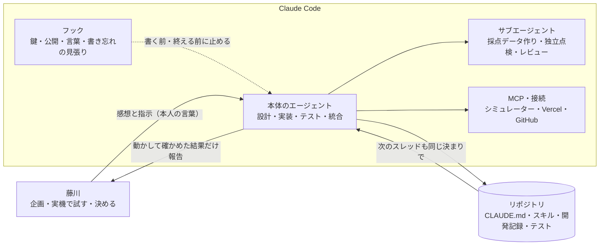

# Claude Code の使い方

制作者の藤川はプログラマーではなく、コードを1行も書いていません。企画・実機での試用・判断を藤川が、設計・実装・テスト・記録を Claude Code が担当しました。ここでは、Claude Code のどの機能を、なぜ選び、どこで効いたかを残します。最終更新：2026-11-07 夜。

**書いてあるのは、実物がリポジトリにあるか、開発記録に使った記録があるものだけです。** まだ使っていないものは、そう書いています。日付と時刻は [開発記録.md](開発記録.md) の見出しです。

## 結論

- **決まりは `CLAUDE.md`、手順はスキル、別の目はサブエージェント、忘れやすいことはフック** と、道具ごとに役目を分けました。
- **アプリの中の AI には言葉の仕事だけ** を任せ、根拠の日付とヒントの漏れはコードが確かめます。
- **うまくいかなかった使い方も、変えた後の使い方と並べて** 残しています。

## 分担

## 使った機能：なぜ選んだか、どこで効いたか

| 機能 | 実物 | なぜその道具を選んだか | 実際に効いた場面 |
|---|---|---|---|
| **`CLAUDE.md`** | [CLAUDE.md](../CLAUDE.md) | セッションやスレッドが変わっても、同じ決まりで作るため。藤川の指示を「守ること」として固定する | 11/03 14:30 の「高齢者は高周波は聞こえないことも考慮してください。ユビキタス、全体的に。」を全体の決まりとして書いた。11/07 18:15 の「ボタンは下半分」も追記。既知の問題（シミュレーターは機種の id で指定する）は 11/07 11:50 につまずいて書き足した |
| **スキル「開発記録」** | [`.claude/skills/dev-log/`](../.claude/skills/dev-log/SKILL.md) | 並行する複数のスレッドが、同じ形（問題 → 原因 → 対応 → 結果、藤川の言葉はそのまま）で書くため。CLAUDE.md に全部書くと長くなるので、手順だけを切り出した | 11/03 15:40 から。11/07 17:34 に全スレッド（12本）と全ブランチを点検し、抜けていた出来事を補った時も、この形で書いた |
| **スキル「公開前の点検」** | [`.claude/skills/pre-publish-check/`](../.claude/skills/pre-publish-check/SKILL.md) | 公開は取り消せない。手順を毎回思い出すのでなく、決まった点検表で行うため | 提出前（11/08）に使う予定。11/07 夜の時点では、まだ実行していない |
| **サブエージェント（その場で呼ぶ）** | 開発記録 | 量の多い作業や、作った本人とは別の目が要る時に、本体の文脈を汚さずに任せる | 11/02 16:30 採点データ一式（架空の記録25日・質問30問）を作らせ、本体が再実行して確かめた。11/03 07:45 公開前に全履歴の鍵と個人情報を独立に点検。11/07 10:25 3つの立場（高齢の方の使い勝手・iOS 技術者・審査員）で同時にレビューし、撮影中に失敗しそうな不具合を4つ見つけた → 11:50〜 9つに分けて直した |
| **サブエージェント（係として固定）** | [`.claude/agents/`](../.claude/agents/)：[高齢の利用者役](../.claude/agents/elder-user-reviewer.md)、[ヒント漏れの審査員](../.claude/agents/hint-leak-judge.md)、[iOS 技術者](../.claude/agents/ios-reviewer.md)、[大会の審査員](../.claude/agents/hackathon-judge.md) | 11/07 午前のレビューがよく効いたので、同じ目をどのスレッドからでも呼べるようにした。どの係も、コードは書き換えず指摘だけを返す決まり（利用者役と審査員は読む道具だけ） | 11/07 16:18 に固定。アプリの目的の中心「答えを漏らさない」を見る係を1人足して4人にした。11/07 20:20、藤川の「実際に点検させて」で、4人を名前で同時に呼んだ。直すたびに係へ見直させ、4回・計9回の呼び出しで26件を直した（[係の点検.md](係の点検.md)）。ヒントの係は、自動の判定では一度も見つからなかった漏れ（「◯月の明日」で日にちが分かる、など）を計5問見つけた |
| **フック：書く前の鍵止め** | [`guard_secrets.py`](../.claude/hooks/guard_secrets.py)（PreToolUse） | git の pre-commit より一歩手前、ファイルに書く前に止めるため。公開が必須の大会なので、鍵は「書かない」が一番安全 | 11/07 16:18 に、止めるべき例と通すべき例を1つずつ流して確かめた |
| **フック：公開の確認** | [`guard_publish.py`](../.claude/hooks/guard_publish.py)（PreToolUse） | 公開の切り替えと強制 push は取り消せない。止めると提出の時に困るので、「止める」でなく「確認を出す」にした | 11/07 16:18 に、`--force` は確認が出て、`--force-with-lease` は通ることを確かめた |
| **フック：医療めいた言葉** | [`check_wording.py`](../.claude/hooks/check_wording.py)（PostToolUse） | 医療アドバイスの AI は大会の失格例。人が見落としやすい言葉を機械に見張らせる。「医療や診断は行いません」のような断り書きは通す | 11/07 16:18 に、知らせる例と通す例を流して確かめた。見張るのは `App/` と中核のコードだけ |
| **フック：終える前の確認** | [`finish_check.py`](../.claude/hooks/finish_check.py)（Stop） | 「できました」の前に、中核を変えていれば `swift test`（Mac だけ）。コードを変えたのに開発記録が無ければ知らせる（藤川の常設依頼） | 11/07 16:25、作った直後に、このフック自身が「開発記録に追記が無い」と言い続ける不具合を見つけた。git が日本語のファイル名を記号の列で出すためで、`-z` で直した |
| **git フック（pre-commit）** | [`.githooks/pre-commit`](../.githooks/pre-commit) | 公開リポジトリが必須なので、初日から鍵と `secrets/`・`private-data/` を仕組みで止める | 11/02 16:04 に作った。11/03 15:33、Gemini の鍵（`AIza…`）が増えたのに止めていないと気づき、形を足した |
| **GitHub Actions「点検」** | [`.github/workflows/secret-scan.yml`](../.github/workflows/secret-scan.yml)、[`check_links.py`](../.github/scripts/check_links.py) | pre-commit を有効にし忘れた時の二重の守り。Ubuntu で数秒の軽い点検だけにした | 11/03 15:40 から。11/07 夜までに130回動き、失敗0回（GitHub の API で確認）。11/07 夜、リンクの点検を、別の文書の見出しへのリンクまで確かめるように直した |
| **自動テスト** | [`CoreTests.swift`](../DowasureCore/Tests/DowasureCoreTests/CoreTests.swift)、[`FlowUITests.swift`](../UITests/FlowUITests.swift) | 藤川はコードを読めない。「できました」は必ず動かして確かめる | 中核の単体テスト58件・画面の通しテスト6本（数えた）。11/07 18:28 に藤川の Mac で全部成功。11/07 16:30〜16:45、ときどき落ちる画面テストを、Mac が残した記録から原因（帯に重なる位置を押していた）を特定して直した（4回中2回失敗 → 4回すべて成功） |
| **採点ツール** | [`DowasureEval/main.swift`](../DowasureCore/Sources/DowasureEval/main.swift) | ヒントの指示文を変えるたびに、同じ30問で比べるため。`--effort` で AI が考える量も比べられる | 11/07 17:45〜18:00 に4回採点し、ヒントの決まりを3回直した（下の「アプリの中の AI」） |
| **並行スレッド** | 開発記録 | 制作・調査・リポジトリの整備を、互いに止めずに進めるため。整備のスレッドはコードを触らない | 11/03 15:30 調査スレッド、15:33 整備スレッド。11/07 は3本の作業（PR #4・#5・#6）が同時に動いた。17:35 に「コンフリクトは起こさないでしょうか？」と聞かれ、新しい作業を止めて、18:00 からまとめ役のスレッド1本で順にまとめた（PR #8） |
| **MCP（iOS シミュレーター操作）** | 開発記録 | コードだけでは分からない「見え方」を、撮影とタップで確かめる | 11/02 16:19 から。日本語の入力と撮影では失敗があり、使い方を変えた（下の表） |
| **MCP・接続（Vercel、GitHub）** | 開発記録 | 声の中継所が動いているか、PR と自動点検の結果を、藤川の手を借りずに確かめる | 11/07 16:45 中継所の URL が応答することを Vercel の取得ツールで確かめた。11/03 15:31 GitHub をプロジェクトにつないだ |
| **決定カード** | 開発記録 | 取り消しにくい選択や、目的が変わる選択は、藤川が1回のタップで選べるようにする | 11/07 16:45「中継所＋決まった言葉の同梱」。11/07 17:33「6つすべて直す」（すすめたのは「1〜4」だったが、藤川が全部を選んだ） |
| **藤川の Mac で動く Claude Code** | 開発記録 | クラウドの作業場所には Swift が無い。ビルドとテストは Mac で行う | 11/07 11:50 以降のテスト結果はすべて Mac での実行。11/07 16:45 中継所への POST も Mac から確かめた |
| **プロジェクトの記憶** | 開発記録 | 藤川の決定（声・モデル・非公開）や常設の依頼を、次のスレッドへ引き継ぎ、同じことを二度聞かない | 11/07 17:34 の点検で、記憶にある「これまでの試行錯誤」27の段階が、すべて開発記録に入っていることを照らし合わせた |

### Claude 以外の AI も「別の目」にした

| 使ったもの | 何をしたか | どう扱ったか |
|---|---|---|
| PR の自動レビュー（Codex） | 11/07 16:25 フックが日本語のファイル名を読めない、17:10 中継所の上限が多すぎる、18:10 画面を離れた後にマイクが入るなど | どれも、こちらで再現するかコードで確かめてから直した |
| 別の AI の調べもの（Meta の Muse） | 11/07 16:09 大会の情報まとめ、18:11 中継所の指摘 | 資料として保存し、指摘は中身を確かめてから答えた（指摘の上限は、すでに1分前に下げていた） |

## アプリの中の AI（Claude API）の使い方

アプリが呼ぶ AI は Claude Haiku 5.5 です。速さと費用から、藤川が決めました（11/03 14:28「使用する LLM はコスト削減のため、Haiku がいいような気がしますね。」）。

**考え方：AI に任せるのは言葉の仕事だけ。確かめる仕事はコードが持つ。**

| 仕事 | だれが | 実物 |
|---|---|---|
| 候補日を最大7日に絞る | コード（端末内） | [`Retriever.swift`](../DowasureCore/Sources/DowasureCore/Retriever.swift#L44) |
| 答え・ヒント3つ・正解とみなす言葉・根拠の日付を作る | AI（1回だけ呼ぶ） | [`Prompts.answerSystem`](../DowasureCore/Sources/DowasureCore/Prompts.swift#L55) |
| 根拠の日付を「AI に渡した日」だけに絞り、日付の文を組み立てる | コード | [`Answerer.verify`](../DowasureCore/Sources/DowasureCore/Services.swift#L73) |
| 答えの漏れたヒントを捨てる | コード | [`Services.swift` 84〜93行](../DowasureCore/Sources/DowasureCore/Services.swift#L84-L93)、[`HintSession.matches`](../DowasureCore/Sources/DowasureCore/HintSession.swift#L98) |
| ヒント → 言い当て → 答え、と進める | コード（追加の呼び出しなし） | [`HintSession.swift`](../DowasureCore/Sources/DowasureCore/HintSession.swift) |

- **構造化出力**（`output_config.format` に JSON スキーマ）：決まった形で受け取り、コードで確かめる。
- **プロンプトキャッシュ**：固定の指示文に `cache_control` を付ける（[`ClaudeClient.swift`](../DowasureCore/Sources/DowasureCore/ClaudeClient.swift#L100)）。
- **混雑と通信切れは1回だけやり直す**（429・529・5xx）。待ち時間の上限は30秒（11/07 11:50）。
- **ワークフロー型**：自律エージェントにせず、手順をコードで決める。11/02 に読んだ Anthropic の「Building Effective Agents」に合わせた。
- **Managed Agents は使わない**：会話がサーバー側に保存されるため、「記録を端末の外に保存しない」と合わない。

### ヒントの指示文を、測って直した（11/07 17:45〜18:00）

本物の Claude で30問を4回採点し、自動の判定に加えて、出たヒントを全部読みました（[記録](開発記録.md#17451800-mac-で確かめヒントの決まりを3回直した)）。

| 回 | 正答 | 漏れ（自動） | 平均の待ち時間 | 読んで見つけたこと → 直したこと |
|---|---|---|---|---|
| 1 | 22/22 | 0/22 | 4.4秒 | ほぼ良い。考える量を low にすると 2.4秒に縮むが、「雪のような色」（白）のような言い換えの漏れが出た → 考える量は既定のまま |
| 2 | 21/22 | 0/21 | 4.3秒 | 言い換えは消えた。数のヒントが弱い → 桁数と最初の数字の両方を言う |
| 3 | 22/22 | 0/22 | 4.4秒 | 答えが1けたの時、最初の数字＝答えそのもの（8時・2位）→ 1けたの時は言わない |
| 4 | 22/22 | 0/22 | 4.3秒 | 漏れは無くなった |

自動の判定は4回とも漏れ0件でした。漏れは全部、読んで見つけました。言い換えの漏れは 11/03 にもあり（「数字は『三』と『二』を並べたもの」）、同じ日の 16:18 に、ヒントを読む係（[hint-leak-judge](../.claude/agents/hint-leak-judge.md)）を固定していました。正直に書くと、この4回の採点で、その係を呼んだ記録はありません。読んだのは、作業をしていた Claude です。11/07 20:20 に初めてその係を呼ぶと、5回目の採点（自動の判定は0問）から、言い換えでなく「今日から数える言い方」の漏れを1問見つけました（[係の点検.md](係の点検.md)）。

## うまくいかなかった使い方と、変えた後

| 試したこと | どうなったか | どう変えたか |
|---|---|---|
| シミュレーター操作の MCP で日本語を入力 | 貼り付け方式で日本語が入らなかった（11/02） | 日本語は画面テスト（XCUITest）の `typeText` で入れる |
| シミュレーター操作の MCP で撮影 | 古い画面が返ることがあった（11/02） | `xcrun simctl io` で直接撮る |
| 料金表をサブエージェントに読ませる | 本文が取れなかった（11/03） | ブラウザで公式ページを直接開いた |
| 画面テストの最中に表示設定を変える | シミュレーターのホーム画面が落ちた（11/03 15:26） | テスト中は設定を変えない（CLAUDE.md の既知の問題） |
| 開発中の試験で Gemini の声を使い続ける | 1日の上限を使い切り、藤川の使用中に声が iPhone に戻った（11/03 14:14） | 試験では使わない。画面テストは iPhone の声にする |
| 「ストリーミングで1秒前後」と見込みを伝える | 測ると約3秒だった（11/03 11:15） | 見込みは測ってから伝える |
| キーの保存を、中身を見ずに「保存できています」と伝えた | 実際は命令文が保存されていた（11/03 07:41） | 確かめてから「できた」と言う |
| ヒントの漏れを、自動の判定だけで見る | 4回とも0件だったが、言い換えの漏れがあった（11/07 17:45） | 出たヒントを全部読む。読む係を固定した |
| 作業の枝を付け替えて強制 push | 安全のための自動の判定で止められた | 上書きせず、merge で残した |
| 3本の作業を同時に進める | 同じ `AskView.swift` と開発記録を触り、ぶつかるおそれ（11/07 17:35） | 触る関数を連絡し合って分け、最後はまとめ役のスレッド1本で順にまとめた |
| 全スレッドへ「細かく記録して」と念押し | 藤川に「今までのものは記録されていないのか」と心配をかけた（11/07 17:34） | 念押しの時は「これまでの分は残っています」を先に言う |
| クラウドの作業場所から、固定した係を名前で呼ぶ | 「その係は無い」と断られた。このリポジトリの係とフックが、そこでは読み込まれていなかった（11/07 20:20） | 藤川の Mac の Claude Code から呼んだ。フックは台本に試しの入力を渡して確かめた |
| `CLAUDE.md` どおり `name=Dowasure-iPhone` でシミュレーターを指定 | Xcode が見つけられず止まった（11/07 11:50） | 機種の id で指定し、CLAUDE.md を書き直した |

## 学んだこと

- シミュレーターと自動テストでは、「怖い」「分かりにくい」は測れない。藤川が実機で触って初めて分かることが多かった。
- 藤川の言葉をそのまま残すと、なぜその作りになったのかが後から分かる。
- 「善意の自動化」（いちばん自然な声を自動で選ぶ）が、かえって怖い声を選んだ。自動で選ぶ時は候補そのものを確かめる。
- 係は「置いただけ」では働かない。実際に呼ぶと、自動の判定では0問だった漏れや、作った本人が気づかない音の残りを見つけた。
- 決まりは、例外まで書かないと逆効果になる（数のヒントの「最初の数字」が、1けたでは答えそのものになった）。

全体の経緯は [開発記録.md](開発記録.md)、審査の観点ごとの案内は [審査員の方へ.md](審査員の方へ.md) にあります。
