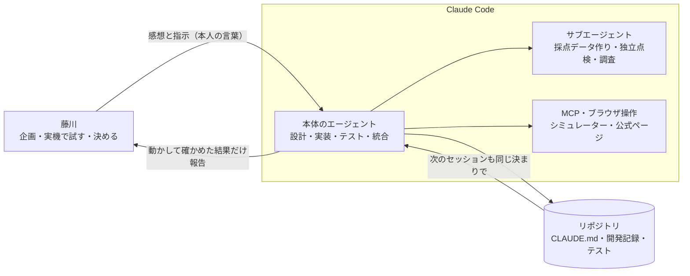

# Claude Code の使い方

制作者の藤川はプログラマーではなく、コードを1行も書いていません。企画・実機での試用・判断を藤川が、設計・実装・テスト・記録を Claude Code が担当しました。ここでは、Claude Code のどの機能を、何のために、どう使い分けたかを残します。最終更新：2026-11-07。

**書いてあるのは実際に使ったものだけです。** これから使う予定のものは、そう書いています。

## 分担

## 使った機能

| 機能 | 何に使ったか | なぜその機能か |
|---|---|---|
| **本体のエージェント** | 設計、実装、テスト、統合、藤川とのやり取り | 全体の判断を一か所に集める |
| **サブエージェント（作る役）** | 採点データ一式（架空の記録25日・質問30問・採点ツール）の作成。本体が結果を再実行して確認 | 量の多い作業を任せ、本体は確認に集中する |
| **サブエージェント（独立の点検役）** | 公開前に、全履歴に API キーや個人情報が入っていないかを点検 | 作った本人とは別の目で見るため |
| **サブエージェント（Web 読み取り）** | 音声合成の仕様調査 | 調べ物の長い本文を本体に持ち込まない |
| **MCP（iOS シミュレーター操作）** | 画面の撮影とタップで、見た目と動きを確認 | コードだけでは分からない「見え方」を確かめる |
| **ブラウザ操作** | Google の料金表を公式ページで確認 | サブエージェントでは本文が取れなかったため |
| **`CLAUDE.md`** | アプリの目的（藤川の言葉）、守ること、構成、既知の問題 | セッションが変わっても同じ決まりで作る。高齢の方向けの決まりもここに書いた |
| **git フック（pre-commit）** | 鍵（`sk-ant-`、`AIza`）や `secrets/`・`private-data/` のコミットを止める | 公開リポジトリが必須なので、初日から仕組みで防ぐ |
| **自動テスト** | 単体テスト35件、画面の通しテスト6本（本物の AI を使うものを含む） | 藤川はコードを読めないので、「できました」は必ず動かして確かめる |
| **プロジェクトの並行スレッド** | アプリの制作、調査（声の比較・残作業）、リポジトリの整備を別々のスレッドで並行 | 互いの作業を止めずに進める。ぶつからないよう、整備のスレッドはコードを書き換えない |
| **プロジェクトのメモリー** | 藤川の決定（声・モデル・非公開）や常設の依頼を、次のスレッドへ引き継ぐ | 同じことを藤川に二度聞かない |

## 2026-11-03 に加えたもの（これから使う）

| 機能 | 場所 | 何をするか |
|---|---|---|
| **プロジェクトのスキル「開発記録」** | [`.claude/skills/dev-log/`](../.claude/skills/dev-log/SKILL.md) | `docs/開発記録.md` への追記の形（問題 → 原因 → 対応 → 結果、藤川の言葉はそのまま）を決める。どのスレッドでも同じ形で書く |
| **プロジェクトのスキル「公開前の点検」** | [`.claude/skills/pre-publish-check/`](../.claude/skills/pre-publish-check/SKILL.md) | 提出前にリポジトリを公開へ戻す時の点検手順 |
| **GitHub Actions「点検」** | [`.github/workflows/secret-scan.yml`](../.github/workflows/secret-scan.yml) | プッシュのたびに、鍵らしい文字列と文書のリンク切れを GitHub 側で点検する。pre-commit を有効にし忘れた時の二重の守り |

## 2026-11-07 に加えたもの

| 機能 | 場所 | 何をするか |
|---|---|---|
| **サブエージェント「高齢の利用者役」** | [`.claude/agents/elder-user-reviewer.md`](../.claude/agents/elder-user-reviewer.md) | 70代でスマホに不慣れな利用者になりきり、迷う所・読めない所・怖い言葉を指摘する |
| **サブエージェント「ヒント漏れの審査員」** | [`.claude/agents/hint-leak-judge.md`](../.claude/agents/hint-leak-judge.md) | ヒントが答えを漏らしていないか、順序とやさしさを、作った本人と別の目で判定する。コードの文字一致では見つからない言い換えの漏れを探す |
| **サブエージェント「iOS 技術者」** | [`.claude/agents/ios-reviewer.md`](../.claude/agents/ios-reviewer.md) | 落ちる・固まる・音が鳴り続ける不具合を探す |
| **サブエージェント「大会の審査員」** | [`.claude/agents/hackathon-judge.md`](../.claude/agents/hackathon-judge.md) | 配点どおりに採点し、点が伸びる直しを出す |
| **フック：書き込み前の鍵止め** | [`.claude/hooks/guard_secrets.py`](../.claude/hooks/guard_secrets.py) | git の pre-commit より一歩手前、ファイルに書く前に鍵と `secrets/` を止める |
| **フック：公開の確認** | [`.claude/hooks/guard_publish.py`](../.claude/hooks/guard_publish.py) | リポジトリの公開切り替えと強制 push は、必ず確認を出す（取り消せない操作のため） |
| **フック：医療めいた言葉** | [`.claude/hooks/check_wording.py`](../.claude/hooks/check_wording.py) | アプリの文に「脳トレ」「認知機能」などが入ったら知らせる（大会の失格例のため） |
| **フック：終える前の確認** | [`.claude/hooks/finish_check.py`](../.claude/hooks/finish_check.py) | 中核を変えていれば自動でテスト。開発記録への追記漏れも知らせる |

11/07 午前のレビューでは、3つの立場のサブエージェントを、その場の指示で同時に動かした。よく効いたので、同じ立場を係としてリポジトリに固定し、どのスレッドからでも同じ目で見られるようにした。

## Claude API（アプリの中の AI）の使い方

アプリが呼ぶ AI は Claude Haiku 5.5 です。速さと費用から、藤川が決めました（2026-11-03）。

- **構造化出力**（JSON スキーマ）：答え・ヒント・根拠の日付を決まった形で受け取り、コードで確かめる。
- **プロンプトキャッシュ**：固定の指示文に `cache_control` を付ける。
- **必要な分だけ送る**：候補日は端末内で選ぶ（最大7日）。Anthropic の「コンテキストエンジニアリング」の考え方に合わせた。
- **ワークフロー型**：自律エージェントにせず、手順をコードで決める。
- **Managed Agents は使わない**：会話がサーバー側に保存されるため、「記録を端末の外に保存しない」と合わない。

## うまくいかなかった使い方

| 試したこと | どうなったか | どうしたか |
|---|---|---|
| シミュレーター操作の MCP で日本語を入力 | 貼り付け方式で日本語が入らなかった | 日本語は画面テスト（XCUITest）の `typeText` で入力 |
| シミュレーター操作の MCP で撮影 | 古い画面が返ることがあった | `xcrun simctl io` で直接撮影 |
| 料金表をサブエージェントに読ませる | 本文が取得できなかった | ブラウザ操作で公式ページを直接開いた |
| 画面テストの最中に表示設定を変える | シミュレーターのホーム画面が落ちた | テスト中は設定を変えない（`CLAUDE.md` の既知の問題に記載） |
| 開発中の試験で Gemini の声を使い続ける | 1日の上限を使い切り、藤川の使用中に声が iPhone に戻った | 試験では使わない。上限時は予備のモデルへ |
| 「ストリーミングで1秒前後」と見込みを伝える | 測ると約3秒だった | 見込みは測ってから伝える |

## 学んだこと

- シミュレーターと自動テストでは、「怖い」「分かりにくい」は測れない。藤川が実機で触って初めて分かることが多かった。
- 藤川の言葉をそのまま残すと、なぜその作りになったのかが後から分かる。
- 「善意の自動化」（いちばん自然な声を自動で選ぶ）が、かえって怖い声を選んだ。自動で選ぶ時は候補そのものを確かめる。

全体の経緯は [開発記録.md](開発記録.md) にあります。
