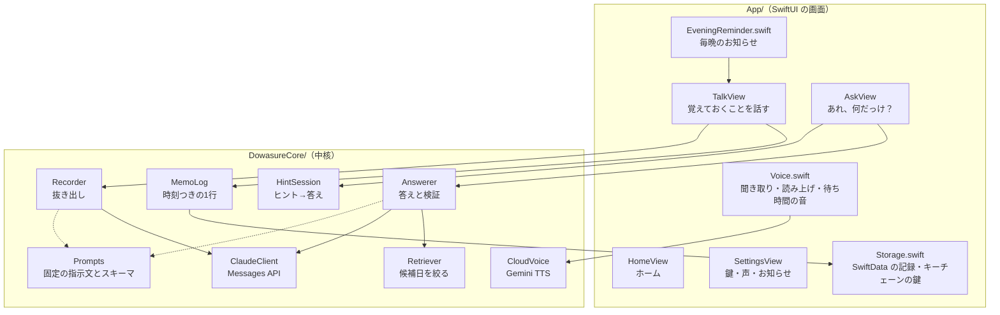
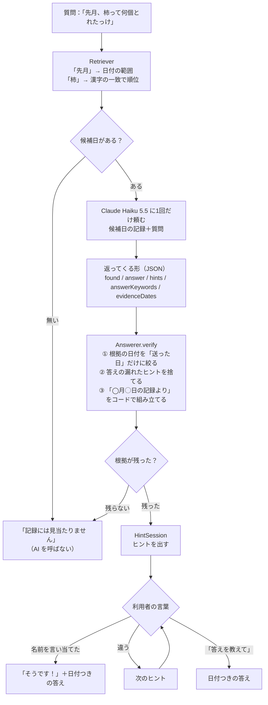

# 設計

ど忘れ相棒の部品と、データの流れをまとめます。コードを読む人向けの案内です。最終更新：2026-11-03。

## 考え方

1. **記録は iPhone の外に置かない。** サーバーを持たず、AI には処理に必要な分だけを送る。
2. **AI に任せるのは言葉の仕事だけ。** 候補日の選び方、根拠の日付、ヒントから答えへの進め方は、アプリのコードが決める。結果が予測でき、テストできる。
3. **自律エージェントにしない。** 手順の決まったワークフロー型。Anthropic の「Building Effective Agents」にある「まず一番簡単な方法で」に合わせた。
4. **中核は画面から切り離す。** `DowasureCore` は Swift Package で、iPhone が無くても Mac で `swift test` できる。

## 全体の構成

## 部品ごとの役割

| 部品 | ファイル | 役割 |
|---|---|---|
| 記録の形 | `Models.swift` | 1日1件の `DayRecord`（日付・話した言葉・抜き出し結果）。抜き出しは人・約束・場所・数字・出来事 |
| 時刻つきの1行 | `MemoLog.swift` | 話した言葉を `[16:05] にんじんを買う` の形でその日の記録に足す。読み返しの文「『…』ですね。覚えました。」も作る |
| 抜き出し | `Services.swift` の `Recorder` | その日の言葉から人・約束などを抜き出す。失敗しても話した言葉は残る |
| 候補日を絞る | `Retriever.swift` | 時期の言葉（昨日、先週、先月、10月8日…）で日付の範囲を決め、名前の一致・文字2つ組の重なり・漢字1文字の一致で順位を付け、最大7日を選ぶ。AI を使わない |
| 答えと検証 | `Services.swift` の `Answerer` | 候補日と質問を AI に送り、返ってきた答えを `verify` で確かめる |
| ヒント→答え | `HintSession.swift` | 弱いヒント → 強いヒント → 答え、の順に端末内で進める。名前を言い当てたか、「答えを教えて」と言ったかを判定する |
| API を呼ぶ | `ClaudeClient.swift` | Messages API を URLSession で直接呼ぶ。構造化出力（`output_config.format` に JSON スキーマ） |
| 指示文 | `Prompts.swift` | 抜き出し役・相談役の指示文とスキーマ。固定文にしてプロンプトキャッシュを効かせる |
| 自然な声 | `CloudVoice.swift`、`App/Voice.swift` | Gemini TTS。1日の上限に達したら別のモデル、それも駄目なら iPhone の声 |
| 毎晩のお知らせ | `App/EveningReminder.swift` | 決めた時刻の通知。押すと話す画面を開く |

## 「あれ、何だっけ？」の中で起きていること

ポイント：

- **AI は1回しか呼ばない。** ヒント・正解とみなす言葉・答えをまとめて受け取るので、2つ目のヒントや答えは待たずに出る。
- **正解の判定は端末内。** 空白・「さん」・ひらがなとカタカナ・全角と半角の違いを無視して、答えの言葉が含まれているかを見る。AI に毎回聞くより速く、結果が予測できる。
- **根拠の日付は AI に書かせない。** AI が返した日付のうち、実際に送った日だけを残す。残らなければ「見当たりません」に倒す。

## Claude API の使い方

| 項目 | 内容 | 理由 |
|---|---|---|
| モデル | Claude Haiku 5.5（`claude-haiku-5-5`） | 速さと費用。採点で十分な正確さが出た（藤川の決定、2026-11-03） |
| 出力 | 構造化出力（JSON スキーマ） | 形が崩れない。コードで確かめられる |
| 指示文 | 固定文 + `cache_control` | プロンプトキャッシュで費用と待ち時間を減らす |
| 送る量 | 抜き出しはその日の言葉、質問は最大7日分 | 必要な分だけ送る（プライバシーと費用） |
| 送らないもの | `temperature` など | このモデルでは送ると 400 エラーになる |
| 読む場所 | 最初の `text` ブロック | Haiku 5.5 は考える過程（thinking）が既定でオンのため |

## 声

| 場面 | 使う声 | 待ち時間 |
|---|---|---|
| 決まり文句（「覚えておきたいことを、話してください。」など） | Gemini の声を iPhone に保存して再生 | ほぼ無し |
| AI の答えやヒント | Gemini の声（届いた分から再生） | 約3秒（計測、2026-11-03） |
| Gemini が使えない時 | iPhone の声（高さ0.9倍） | ほぼ無し |

- 個人の記録を含む声は iPhone に保存しない。保存するのは決まり文句だけ。
- 待ち時間は、アプリの中で計算して作る低い「ポンポンポン」（392Hz、こだまと響きつき）を鳴らす。音声素材を使わないので権利の心配が無い。

## 使っていない部品

- `Interviewer.swift`（AI が1問ずつ聞く「夜の聞き取り」）：藤川の判断で画面から外した（2026-11-03）。部品は残してある。

## 関連

- データの行き先：[プライバシーと安全.md](プライバシーと安全.md)
- 採点：[採点.md](採点.md)
- 経緯：[開発記録.md](開発記録.md)
