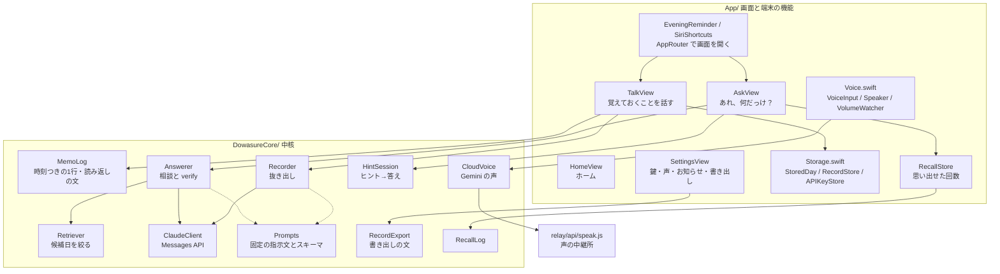
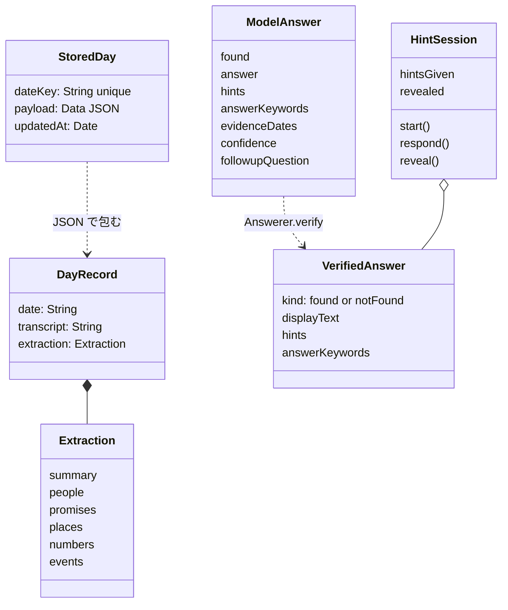
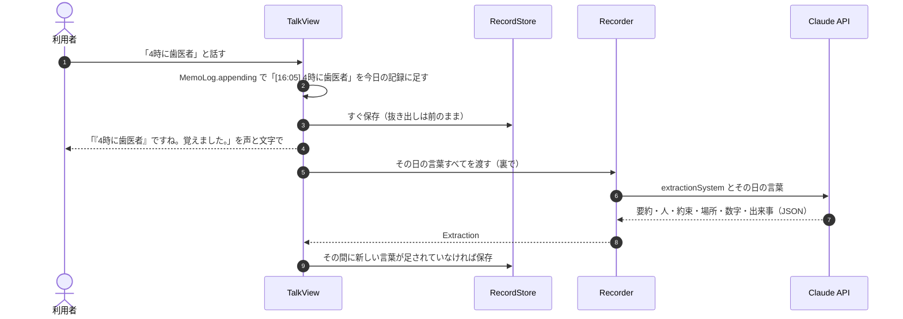
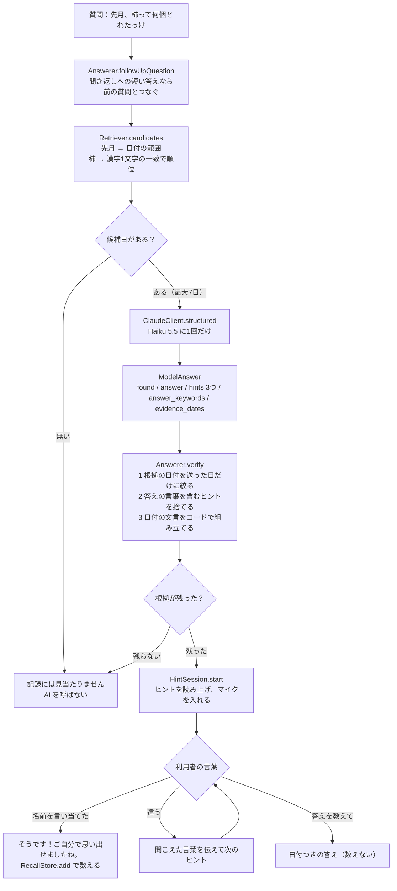
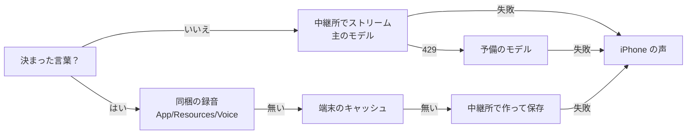

# 設計

> **3行でいうと**
> 1. **答えを教えず、思い出す手伝いをします。** 忘れそうなことを話せば覚え、「何だっけ」の時はヒントを3段で出します。答えの言葉がそのまま入ったヒントはコードが捨て、言い換えの漏れは別の Claude（ヒントの係）が読んで点検しました。医療や診断はしません。
> 2. **高齢の方のために、細かいところまで作り込みました。** 65歳の藤川が実機で試し、その言葉で直す、を繰り返しました。直したことは [11行の表](../README.md#高齢者に使いやすくするために直したこと)に、藤川の言葉80件以上とうまくいかなかった案40件以上は [開発記録](開発記録.md) に残しています。
> 3. **何人もの Claude で、いろいろな方向から作り、点検しました。** 4人の係（Claude Code のサブエージェント。高齢の利用者役・ヒントの審査員・iOS の技術者・大会の審査員）に点検させて26件を直しました（[係の点検](係の点検.md)）。鍵の書き込みや医療めいた言葉は、フックが止めたり知らせたりします（[Claude活用](Claude活用.md)）。

**この文書で分かること：** ど忘れ相棒の部品ごとの責務、「記録する時」「思い出す時」のデータの流れ、AI に任せずコードで決めていること、失敗した時の倒し方、1〜2年使う前提の保存の形です。名前はすべて実際のファイル名・型名・関数名で書き、ファイルへのリンクを付けました。

最終更新：2026-11-07。数字の出典は [開発記録.md](開発記録.md) と、ここに書いたコードです。

## 1. 考え方

1. **記録は iPhone の外に置かない。** 作者のサーバーに記録を置かない。AI には、処理に必要な分だけを送る。
2. **AI に任せるのは言葉の仕事だけ。** どの日を送るか、根拠の日付、ヒントから答えへの進め方、正解かどうかは、アプリのコードが決める。結果が予測でき、テストできる。
3. **自律エージェントにしない。** 手順の決まったワークフロー型。AI を呼ぶのは「抜き出し」と「相談」の2か所だけで、どちらも1回の呼び出しで終わる。
4. **中核は画面から切り離す。** [`DowasureCore`](../DowasureCore/Package.swift) は Swift Package。iPhone が無くても Mac で `swift test` できる。

## 2. 全体の構成

## 3. 部品ごとの責務

### 中核（`DowasureCore/Sources/DowasureCore/`）

| ファイル | 主な型・関数 | 責務 |
|---|---|---|
| [Models.swift](../DowasureCore/Sources/DowasureCore/Models.swift) | `DayRecord`、`Extraction`、`ModelAnswer`、`VerifiedAnswer` | 記録の形（1日1件。日付・話した言葉・抜き出し結果）。AI から届いた生の答え（`ModelAnswer`）と、コードで確かめた後の答え（`VerifiedAnswer`）を別の型にしている |
| [MemoLog.swift](../DowasureCore/Sources/DowasureCore/MemoLog.swift) | `MemoLog.appending`、`MemoLog.confirmation` | 話した言葉を `[16:05] にんじんを買う` の形でその日に足す。読み返しの文「『…』ですね。覚えました。」を作る |
| [Services.swift](../DowasureCore/Sources/DowasureCore/Services.swift) | `Recorder.extract`、`Answerer.answer`、`Answerer.verify`、`Answerer.followUpQuestion` | 抜き出しと相談の手順。`verify` が根拠の日付・日付の文言・ヒント漏れをコードで処理する |
| [Retriever.swift](../DowasureCore/Sources/DowasureCore/Retriever.swift) | `DayCalendar`、`Retriever.dateRange`、`Retriever.candidates`、`Retriever.score` | 時期の言葉を日付の範囲に直し、順位を付けて最大7日を選ぶ。AI を使わない |
| [HintSession.swift](../DowasureCore/Sources/DowasureCore/HintSession.swift) | `HintSession.start`、`respond(to:)`、`moreHint`、`reveal`、`matches`、`isCorrectGuess` | ヒントから答えまでの会話を端末内で進める。言い当てたか、「答えを教えて」と言ったかを判定する |
| [ClaudeClient.swift](../DowasureCore/Sources/DowasureCore/ClaudeClient.swift) | `ClaudeClient.structured`、`sendWithOneRetry`、`checkKey`、`ClaudeError` | Messages API を URLSession で直接呼ぶ。構造化出力、1回だけの再試行、やさしい言葉のエラー |
| [Prompts.swift](../DowasureCore/Sources/DowasureCore/Prompts.swift) | `extractionSystem`、`answerSystem`、`answerSchema`、`renderRecords` | 固定の指示文と JSON スキーマ。候補日の記録を AI 向けの文にする |
| [CloudVoice.swift](../DowasureCore/Sources/DowasureCore/CloudVoice.swift) | `CloudVoice.relay`、`stream`、`synthesize` | Gemini の声を、中継所経由（ふつう）か開発者の鍵で直接（DEBUG のみ）頼む |
| [RecallLog.swift](../DowasureCore/Sources/DowasureCore/RecallLog.swift) | `RecallLog.add`、`countInLastWeek`、`homeMessage` | 「自分で思い出せた」回の記録。最大1000件。0回の時は何も出さない |
| [RecordExport.swift](../DowasureCore/Sources/DowasureCore/RecordExport.swift) | `RecordExport.text`、`fileName` | 書き出し用の文（古い日から順に「話したこと」と「まとめ」） |
| [VoiceTiming.swift](../DowasureCore/Sources/DowasureCore/VoiceTiming.swift) | `VoiceTiming.silenceTimeout` | 話し始めるまで20秒、話し始めてからは4秒の間で区切る |
| [SampleData.swift](../DowasureCore/Sources/DowasureCore/SampleData.swift) | `SampleData.records` | 試す時の架空の記録（5日分） |
| [JSONValue.swift](../DowasureCore/Sources/DowasureCore/JSONValue.swift) | `JSONValue`、`Schema` | スキーマを Swift で書くための小さな JSON の型 |

### 画面と端末の機能（`App/`）

| ファイル | 主な型・関数 | 責務 |
|---|---|---|
| [DowasureApp.swift](../App/DowasureApp.swift) | `DowasureApp`、`Palette`、`WarningText`、`Style`、`BigButton`、`ThumbDock`、`ElderScreen`、`wrapsForLargeText()` | 起動と保存場所の用意。全画面で使う見た目の部品（[ユニバーサルデザイン.md](ユニバーサルデザイン.md)） |
| [Storage.swift](../App/Storage.swift) | `StoredDay`、`RecordStore`、`APIKeyStore` | SwiftData への保存と読み出し。鍵はキーチェーン |
| [TalkView.swift](../App/TalkView.swift) | `remember(_:)`、`undoLast()` | 話した言葉をすぐ保存し、読み返し、裏で抜き出す。直前の1件を取り消す |
| [AskView.swift](../App/AskView.swift) | `startAsking()`、`ask(generation:)`、`respond(_:)`、`speak(_:)` | 質問を1つずつ送り、ヒントを読み上げてからマイクを入れる |
| [HomeView.swift](../App/HomeView.swift) | `HomeView`、`Route` | ホーム。準備がまだの時の案内、思い出せた回数 |
| [SettingsView.swift](../App/SettingsView.swift) | `checkKey()`、`RecordsFile`、`loadSamples()` | 鍵の保存と1回の確認、声、お知らせ、記録の書き出しと全消去 |
| [Voice.swift](../App/Voice.swift) | `VoiceInput`、`Speaker`、`VolumeWatcher`、`MicButton`、`MicStatus`、`RepeatButton`、`VolumeWarning` | 聞き取り（Speech）と読み上げ（Gemini / iPhone の声）、待ち時間の音、音量0の扱い |
| [RecallStore.swift](../App/RecallStore.swift) | `RecallStore` | `RecallLog` を UserDefaults に置く |
| [EveningReminder.swift](../App/EveningReminder.swift) | `EveningReminder.schedule`、`AppRouter`、`AppDelegate` | 毎晩のお知らせ。押すと話す画面を開く |
| [SiriShortcuts.swift](../App/SiriShortcuts.swift) | `RememberIntent`、`RecallIntent`、`DowasureShortcuts` | Siri の言い方7つ（覚える4つ、思い出す3つ）で画面を開く |

### 声の中継所（`relay/`）

| ファイル | 主な関数 | 責務 |
|---|---|---|
| [relay/api/speak.js](../relay/api/speak.js) | `validate`、`tooMany`、`POST` | 読み上げる文を Gemini に取り次ぐ。Google の鍵はサーバーの環境変数 `GEMINI_API_KEY` だけ。詳しくは [プライバシーと安全.md](プライバシーと安全.md) |

## 4. 主要な型の関係

- `ModelAnswer` は AI の言い分、`VerifiedAnswer` はアプリが確かめた後の答え。画面と声に出るのは `VerifiedAnswer` だけ。
- `HintSession` は値型（struct）。AI を呼ばないので、ヒントから答えまでの動きは単体テストで全部確かめられる。

## 5. データの流れ

### 記録する時（「覚えておくことを話す」）

- **言葉の保存を先にする。** 抜き出しは後から裏で行う。通信に失敗しても、キーが無くても、話した言葉は残る。
- **追い越しを防ぐ。** 抜き出しが返ってきた時、保存してある言葉が送った時と同じかを確かめてから上書きする（`TalkView.remember`）。同じでなければ捨て、次に話した時に作り直す。
- **取り消し。** `undoLast()` は1つ前の言葉に戻し、抜き出しを作り直す。

### 思い出す時（「あれ、何だっけ？」）

- **AI は1回しか呼ばない。** ヒント3つ・正解とみなす言葉・答え・根拠の日付をまとめて受け取る。2つ目のヒントや答えは待たずに出る。
- **候補日が空になるのは、** 記録が1日も無い時か、時期の言葉で絞った範囲に記録が無い時だけ。時期の言葉が無い質問は、全部の日から順位の高い7日を送る。
- **AI に送る記録の形**は `Prompts.renderRecords` が作る。要約、人・約束・場所・数字・出来事、そして話した言葉の行（`[` で始まる行）。
- ヒントは3段（場面 → 手がかり → 最初の1音）。数の答えでの決まりは `Prompts.answerSystem` にある（1けたの答えでは最初の数字を言わない、など。2026-11-07 の採点で直した）。

## 6. AI に任せないこと

AI が間違えても、利用者に間違った根拠や答えが届かないようにする所です。

| 何を | どこで | どうしているか | なぜ |
|---|---|---|---|
| どの日を AI に送るか | `Retriever.candidates` | 時期の言葉で範囲を決め、名前の一致（+10）、文字2つ組の重なり、漢字1文字の一致（+2）で順位を付け、上から最大7日 | 全部の記録を送らない（プライバシーと費用）。同じ質問なら同じ日が選ばれる |
| 根拠の日付 | `Answerer.verify` | AI が返した `evidence_dates` のうち、実際に送った日だけを残す。1つも残らなければ「見当たりません」に倒す | 記録に無い日を根拠にした作り話を、形で防ぐ |
| 日付の文言 | `Answerer.verify`、`DayCalendar.spokenLabel` | 「10月8日の記録より：」はコードが組み立てる。AI の `answer` には日付を書かせない | 日付の書き間違いが起きない |
| ヒント漏れ | `Answerer.verify`、`HintSession.matches` | 正解とみなす言葉（`answer_keywords`）を含むヒントを捨てる。空白・「さん」・ひらがなとカタカナ・全角と半角の違いは無視して比べる | 答えをいきなり言わない、というアプリの目的を AI 任せにしない |
| ヒントが全部消えた時 | `Answerer.verify` | 代わりに「10月8日に覚えておいたことです。」を出す。日付そのものが答えの時は、この代わりのヒントも使わず、正直に答えを言う（自分で思い出せた回には数えない） | 代わりのヒントが答えを漏らした不具合を 11/07 に直した（`dateHintIsNotUsedWhenTheDateIsTheAnswer`） |
| 正解かどうか | `HintSession.isCorrectGuess` | 答えの言葉が含まれるかを端末内で見る。1文字の言葉は、その1文字だけを言った時に限る | 速く、結果が予測できる。「森」で「森本」を正解にしない |
| 「答えを教えて」「もう少し」 | `HintSession.asksForAnswer`、`asksForHint` | 決まった言葉の一覧で判定 | 同上 |
| 外れた時の言い方 | `HintSession.notMatchedPrefix` | 「『守田さん』と聞こえました」と聞こえた言葉を返す | 音声認識が別の漢字で返した時に、ただ「違う」と言わない |
| 時刻つきの記録と読み返し | `MemoLog` | 本人の言葉をそのまま残し、そのまま読み返す | 聞き間違いにその場で気づける |
| エラーの言葉 | `ClaudeError.errorDescription` | 数字や専門用語を出さない、やさしい文 | 高齢の利用者向け |

限界：ヒント漏れの点検は、AI が返した `answer_keywords` に頼っている。言葉を変えて実質的に答えを言うヒントは、この点検では見抜けない。採点では採点データ側の正解の言葉で別に確かめ、さらにヒントを人の目で全部読んでいる（[採点.md](採点.md)）。

## 7. 失敗した時の倒し方

| 起きたこと | どう倒すか | コード |
|---|---|---|
| 混み合い（429・529・5xx） | 1回だけやり直す。待ちは `retry-after` が5秒以内ならその秒数、ほかは1.5秒 | `ClaudeClient.sendWithOneRetry`、`retryWait` |
| 一瞬の通信切れ（接続が切れた・ホストにつながらない・名前が引けない） | 1回だけやり直す | 同上 |
| 圏外・時間切れ | やり直さない（待ち時間を2倍にしない）。「インターネットにつながっていないようです」などの文 | `ClaudeError.from` |
| 返事が来ない | 30秒で止める（キーの確認は15秒） | `ClaudeClient.timeout`、`checkKey` |
| キーが違う（401・403） | やり直さない。「使う準備に問題があるようです」（利用者に「APIキー」の言葉は見せない） | `ClaudeError.errorDescription` |
| 断られた・途中で切れた・形が違う | 「うまくお答えできませんでした」などの文 | `ClaudeError.refusal`、`truncated`、`decoding` |
| 候補日が無い | AI を呼ばずに「見当たりません。いつ頃のことか、覚えていますか？」 | `Answerer.answer` |
| 根拠の日付が残らない | 「見当たりません」 | `Answerer.verify` |
| 抜き出しに失敗・キーが無い | 話した言葉は保存済み。赤い警告ではなく落ち着いた一文。まとめは次に話した時に作り直す | `TalkView.remember` |
| エラー全般 | 文字で出し、同じ文を読み上げる | `AskView.ask`、`TalkView.remember` |
| Gemini の1日の上限（429） | 予備のモデルに替える。上限に達したモデルは1時間、端末に記録して飛ばす | `Speaker.modelsToTry`、`markRateLimited` |
| 声が届かない | 12秒音が来なければあきらめ、iPhone の声で話す | `CloudVoice.stream` |
| 音量がほぼ0（6%未満） | 声を出さずにすぐ次へ進む。話している途中で0にしたら止める | `Speaker.sayAndWait`、`VolumeWatcher` |
| 着信・Siri で音が止められた | 聞き取りと声を止め、待っている処理を放す | `VoiceInput.observeInterruptions`、`Speaker.init` |
| 画面を離れた | 相談の処理・ヒントの処理を取り消し、聞きかけの言葉は捨て（`cancel`）、声と通信音を止める | `AskView.onDisappear`、`TalkView.onDisappear`、`Speaker.stopEverything` |
| 古い質問の続きが新しい質問を邪魔する | 質問ごとに番号（`askGeneration`）を付け、最新の質問だけがマイクを入れる | `AskView.startAsking` |
| 保存の場所が開けない | 落ちずに、メモリだけの保存で起動し「これまでの記録を開けませんでした。記録は消していません。」と伝える。ファイルは消さない | `DowasureApp.init` |

声の経路は次の順に試し、どこで失敗しても最後は iPhone の声で話す（`Speaker.sayAndWait`）。

## 8. 保存の設計（1〜2年使う前提）

藤川さんの依頼（2026-11-07 16:13）：「ユーザーは1〜2年使うことを想定して、ユーザーの入力（音声入力〜テキスト化したもの）どこに記録していくのかということも慎重に考えてください。」

### 形

| 何を | どこに | 形 |
|---|---|---|
| 記録（1日1件） | SwiftData の `StoredDay`（[Storage.swift](../App/Storage.swift)） | `dateKey`（`yyyy-MM-dd`、重複なし）、`payload`（`DayRecord` の JSON）、`updatedAt` |
| 話した言葉 | `DayRecord.transcript` | 1行1件、`[16:05] にんじんを買う` |
| 思い出せた回 | UserDefaults の `recallLog`（[RecallStore.swift](../App/RecallStore.swift)） | `RecallLog` の JSON。最大1000件 |
| 鍵 | キーチェーン（`APIKeyStore`） | 「この iPhone だけ」 |

- **記録を JSON で包む理由：** SwiftData の形（`StoredDay` の3つの欄）を変えずに、記録の中身（`DayRecord`）を変えられる。日付の鍵だけを SwiftData の欄にして、日付での取り出しを速くしている。
- **中身を変える時の決まり：** 古い JSON に無い欄を足す時は、読み込みで省略を許す（`decodeIfPresent`。`ModelAnswer` が同じ書き方をしている）。省略を許さないと、古い日の記録が読めなくなる。読めない日は消えないが、画面・検索・書き出しから外れる（`RecordStore.allRecords` は読めない日を飛ばす）。

### 量の見積もり

| もの | 見積もり | 出典 |
|---|---|---|
| 記録 | 架空データの1日分は平均約380文字。多めに1日2,000文字と見て、2年で約4.4MB | 開発記録 11/07 16:14（検算済み・Python） |
| 1回の質問で送る量 | 最大7日分。Haiku の料金が上がる10万トークンには届かない。多めの見積もりで1回約0.4円 | 同上（見積もり） |
| 思い出せた回 | 最大1000件、約50KB | `RecallLog.maxEntries`、開発記録 11/07 16:18 |
| 同梱の声 | 8本、合わせて約0.9MB | `App/Resources/Voice` |

- 質問のたびに `RecordStore.allRecords` で全部の日を読み、端末内で絞っている。2年分（約730日）で何秒かかるかは、まだ測っていない。

### 控え・移行・消去

- **書き出し：** 設定 →「記録の保管（ご家族向け）」→「記録を書き出す（○日分）」。`RecordExport.text` がテキストファイル（`ど忘れ相棒の記録_日付.txt`）を作り、共有シートでファイル App・AirDrop・メールに渡す。文はボタンを押した時に作る。
- **機種変更：** iPhone のバックアップ（iCloud バックアップや直接転送）がオンなら、記録も移る。鍵は「この iPhone だけ」なので移らず、入れ直す。
- **iCloud での同期は入れていない。** 「記録を端末の外に置かない」という約束と合わないため（開発記録 11/07 17:33 の5番）。
- **消去：** 「記録の保管」→「記録を消す」の奥に置き、確認の文に「○日分」と出す。先に書き出すよう書き添えている。

### 壊れた時

| 起きたこと | 動き |
|---|---|
| 保存の場所が開けない | 落ちずに起動する。メモリだけの保存に切り替え、「これまでの記録を開けませんでした。記録は消していません。iPhone を再起動してから…」と伝える。それまでに話したことは、アプリを閉じると残らないことも伝える |
| 1日分の JSON が読めない | その日だけを飛ばす。消さない |
| 架空の記録を入れる | 記録がすでにある日には入れない（本物の記録を上書きしない）。入れなかった日数を出す |

## 9. 設計の判断と、捨てた案

| 決めたこと | 理由 | 捨てた案 |
|---|---|---|
| 手順の決まったワークフロー型 | 結果が予測でき、テストできる。Anthropic の「Building Effective Agents」の「まず一番簡単な方法で」に合わせた（11/02） | 自律エージェント。Managed Agents（会話がサーバー側に保存され、端末の外に置かない約束と合わない） |
| 相談の AI 呼び出しは1回。ヒント3つ・正解とみなす言葉・答えをまとめて受け取る | 2つ目のヒントと答えに待ちが無い。正解の判定も端末内でできる | ヒントのたびに AI を呼ぶ、言い当てたかを AI に聞く |
| 候補日を端末内で絞る（最大7日） | 送る量を減らす（プライバシーと費用）。同じ質問なら同じ日 | すべての記録をまとめて送る |
| 根拠の日付・日付の文言はコード | 作り話を形で防ぐ（11/02 16:19） | AI が書いた日付をそのまま出す |
| 構造化出力（JSON スキーマ） | 形が崩れず、コードで確かめられる | 自由な文から読み取る |
| Claude Haiku 5.5 | 速さと費用。採点で十分な正確さ（藤川さんの決定、11/03 14:28） | 上位モデル（比べてはいない） |
| 考える量（effort）は既定のまま | `low` は平均2.4秒と速いが、言い換えで答えを言うヒントが出た（「雪のような色」＝白） | `low`（11/07 17:45 の採点） |
| ヒントは3段（場面→手がかり→最初の1音） | 2段では出来にばらつきがあった。手本を5種類入れた | 2段のヒント、手本なし |
| 話した言葉をすぐ保存し、抜き出しは後 | 通信に失敗しても言葉は残る（11/03 14:19） | 抜き出しが終わってから保存 |
| 自分から話す形 | 「何か話しかけられて答えるのではなくて」（藤川さん、11/03 14:19） | AI が1問ずつ聞く夜の聞き取り（`Interviewer.swift` は残してあるが画面からは使っていない） |
| 記録は SwiftData に JSON で包んで1日1件 | 形を変えやすく、日付で引ける | iCloud での同期（端末の外に置かない約束） |
| 声は Gemini、鍵は中継所だけ | 利用者が入れる鍵を Claude の1つにする（11/07 16:45） | 利用者に Google の鍵を入れてもらう、鍵をアプリに埋め込む（公開リポジトリから抜かれる）、無料の音声合成エンジンを同梱（締切前は危ない） |
| 決まった言葉の声は同梱 | 最初の起動から待たずに鳴る | 毎回作る |
| 待ち時間は言葉でない音 | 相づちは声の調子が変わり、AI の言葉と重なった（11/03 14:09） | 相づち |
| ボタンは画面の下半分の帯（`ThumbDock`） | 「親指はiPhoneに対して下半分しか使えません」（藤川さん、11/07） | 画面の上から順に並べる |
| 中継所は回数の上限で守る | 使い切られても Google の1日の枠で止まり、費用は増え続けない。アプリは同梱の録音と iPhone の声で話し続ける | 合言葉をアプリに埋める（抜かれる）。App Attest は提出後の宿題 |

## 10. Claude API の使い方

| 項目 | 内容 | 理由 |
|---|---|---|
| モデル | `claude-haiku-5-5`（`ClaudeModel.haiku`） | 上の表 |
| 出力 | `output_config.format` に JSON スキーマ | 形が崩れない |
| 指示文 | 固定文、`cache_control: ephemeral` | プロンプトキャッシュで費用と待ち時間を減らす |
| 送る量 | 抜き出しはその日の言葉、相談は最大7日分の記録と「今日の日付」と質問 | 必要な分だけ |
| 送らないもの | `temperature` など | このモデルでは送ると 400 エラーになる |
| 読む場所 | 最初の `text` ブロック | Haiku 5.5 は考える過程（thinking）が既定でオンで、その後に答えが来る |
| `max_tokens` | 8000 | 考える過程の分も含めて切れないように |
| 待ち | 30秒、1回だけ再試行 | 7章 |

## 11. 声

| 場面 | 使う声 | 待ち時間 |
|---|---|---|
| 決まった言葉4つ（「覚えておきたいことを、話してください。」「何を思い出したいですか？」など） | アプリに同梱した Gemini の録音（声「あたたかい声」のゆっくり・ふつう、計8本）。ほかの声は初回に作って端末に保存 | ほぼ無し |
| 答えやヒント、読み返し | 中継所経由の Gemini の声（届いた分から再生） | 約3秒（11/03 に Mac から計測） |
| Gemini が使えない時、「すぐ話す声」を選んだ時 | iPhone の声（高さ0.9倍） | ほぼ無し |

- 個人の記録を含む声は端末に保存しない。保存するのは決まった言葉だけ（`Speaker.cacheURL`）。
- 待ち時間の「ポンポンポン」と、言い当てた時のチャイムは、アプリの中で計算して作る（`Speaker.tonePattern`、`chimePattern`）。音声素材を使わない。

## 12. テスト

| 種類 | 件数（コードで数えた） | 確かめた結果（開発記録） |
|---|---|---|
| 中核の単体テスト（Swift Testing、[CoreTests.swift](../DowasureCore/Tests/DowasureCoreTests/CoreTests.swift)・[EvalFixtureTests.swift](../DowasureCore/Tests/DowasureCoreTests/EvalFixtureTests.swift)） | 60件 | 今のコード（5c5110c）で 60件すべて成功（11/07 夜） |
| 画面の通しテスト（XCUITest、[FlowUITests.swift](../UITests/FlowUITests.swift)） | 6本（本物の Claude を使う2本を含む）。ほかに README の画面写真を撮るだけの [ScreenshotTests.swift](../UITests/ScreenshotTests.swift) 1本（ふだんは飛ばす） | 今のコード（5c5110c）で 6本成功（11/07 夜） |
| 中継所のテスト（`node --test`、[speak.test.js](../relay/speak.test.js)） | 6件 | 11/07 17:10 に 6件成功 |
| 採点（[DowasureEval](../DowasureCore/Sources/DowasureEval/main.swift)） | 30問 | [採点.md](採点.md) |

AI を使う部分の単体テストは、`HTTPTransport` を模擬のものに差し替えて、通信せずに確かめている。

## 13. 使っていない部品

- `Interviewer.swift` と `Prompts.interviewSystem`（AI が1問ずつ聞く夜の聞き取り）：藤川さんの判断で画面から外した（11/03 14:19）。採点ツールの `--interview-demo` だけが使う。壊す危険を避けて消していない（11/07）。
- `ClaudeModel.sonnet`、`Speaker.hasHighQualityDeviceVoice`：定義だけで、今は使っていない。

## 関連

- 送るもの・保存するもの：[プライバシーと安全.md](プライバシーと安全.md)
- 見た目と音の決まり：[ユニバーサルデザイン.md](ユニバーサルデザイン.md)
- 採点：[採点.md](採点.md)
- 経緯：[開発記録.md](開発記録.md)
